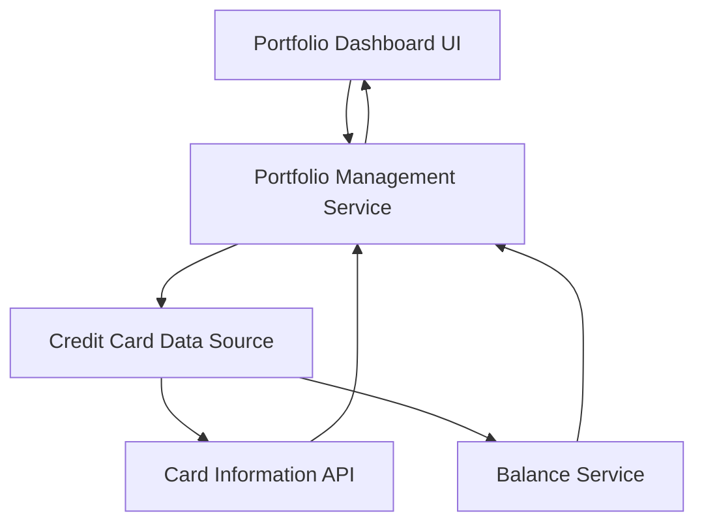

#### 1. High-Level Design

- **Summary:** This epic enables users to view and manage multiple credit cards through a single consolidated interface. The solution provides a comprehensive portfolio overview displaying key information for each card including credit limits, available credit, and outstanding balances. The feature eliminates the need for users to access multiple banking portals, centralizing visibility and control over their entire credit card portfolio.

- **Component Flow:**

- **Integration Points:**
  - **Upstream:** Credit card data sources for retrieving card information, balances, and limits
  - **Upstream:** Card Information API for card details and metadata
  - **Upstream:** Balance Service for current balance and outstanding amount data
  - **Downstream:** Portfolio Dashboard UI for consolidated multi-card display

- **Key Assumptions:**
  - Card data is retrieved via secure API calls with appropriate authentication and authorization
  - Portfolio view displays all active cards associated with the authenticated user account

- **NFR Highlights:** System must provide responsive layouts across desktop, tablet, and mobile devices; dashboard must load within 2 seconds for optimal user experience

- **Data Flow:** User authentication triggers the Portfolio Management Service to retrieve all cards associated with the user from the Credit Card Data Source. The service makes parallel calls to the Card Information API (for card details, limits) and Balance Service (for available credit, outstanding balances). Retrieved data is consolidated and formatted by the Portfolio Management Service, then rendered in the Portfolio Dashboard UI as a unified view showing all cards with their respective credit limits, available credit, and outstanding balances. The responsive UI adapts layout based on device type while maintaining the 2-second load time requirement.

#### 2. Validation Report

- **Requirements Coverage:** The design fully addresses the epic's scope including multiple credit card display, credit limit tracking, available credit monitoring, outstanding balance visibility, and portfolio overview functionality. The architecture supports centralized visibility by consolidating data from multiple sources into a single interface. NFRs for responsive layouts across all device types and 2-second dashboard load time are architecturally supported through efficient service design and UI optimization. The design appropriately excludes out-of-scope items (real bank integration, card payments, fund transfers, loans, payment gateway integration) as specified in the epic.