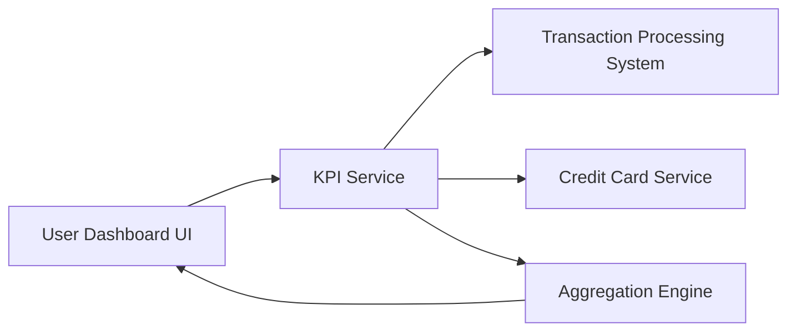

#### 1. High-Level Design

- **Summary:** This epic delivers a comprehensive KPI dashboard displaying four critical financial metrics: Monthly Spend (total expenditure for current month), Total Credit Limit (aggregated across all cards), Available Credit (remaining spending capacity), and Outstanding Amount (total dues). The dashboard provides users with real-time or near real-time visibility into their credit card financial health, enabling informed financial decisions and credit utilization awareness.

- **Component Flow:**

- **Integration Points:**
  - **Upstream:** Transaction processing system for monthly spend data retrieval
  - **Upstream:** Credit card service for credit limit, available credit, and outstanding balance information
  - **Downstream:** Dashboard UI for KPI visualization and display

- **Key Assumptions:**
  - Monthly spend is calculated based on posted transactions within the current calendar month
  - KPI refresh frequency is configurable to balance real-time requirements with system performance

- **NFR Highlights:** KPI data must refresh in real-time or near real-time; system must accurately calculate aggregated metrics across multiple cards; dashboard must be responsive across all device types (desktop, tablet, mobile)

- **Data Flow:** The KPI Service orchestrates data retrieval from two primary sources: the Transaction Processing System provides current month transaction data for Monthly Spend calculation, while the Credit Card Service supplies credit limits, available credit, and outstanding balances for each card. The Aggregation Engine consolidates data across multiple cards to compute Total Credit Limit, Available Credit, and Outstanding Amount. Aggregated KPI values are pushed to the User Dashboard UI in real-time or near real-time, where they are displayed as visual metrics with appropriate formatting and responsive layouts.

#### 2. Validation Report

- **Requirements Coverage:** The design comprehensively addresses all four KPI requirements (Monthly Spend, Total Credit Limit, Available Credit, Outstanding Amount) with clear data sources and aggregation logic. The architecture supports real-time/near real-time data refresh through the KPI Service and Aggregation Engine. Multi-card aggregation accuracy is ensured through dedicated aggregation logic. Responsive design across all device types is supported at the UI layer. The design explicitly excludes out-of-scope elements (real bank integration, payment processing, fund transfers, predictive analytics, budget alerts) as specified in the epic.