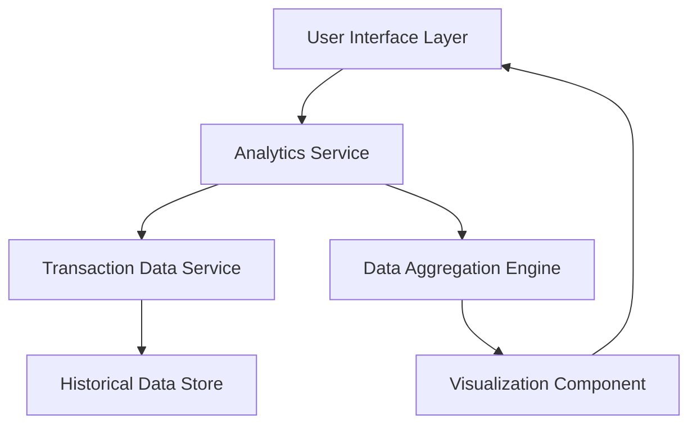

#### 1. High-Level Design

- **Summary:** This epic delivers interactive visualization and analytics capabilities enabling users to understand spending patterns across multiple dimensions. The solution provides monthly trend analysis, card-wise spend comparison, and category-based spending breakdowns across nine predefined categories (Food & Dining, Fuel, Shopping, Travel, Entertainment, Utilities, Healthcare, Education, Miscellaneous). The system supports drill-down capabilities and historical data analysis to help users identify spending hotspots and optimize card usage.

- **Component Flow:**

- **Integration Points:**
  - **Upstream:** Transaction data service for retrieving historical spending information
  - **Upstream:** Analytics engine for data aggregation and categorization logic
  - **Downstream:** User interface components for rendering interactive charts and visualizations

- **Key Assumptions:**
  - Transaction categorization is performed by the analytics engine using predefined rules; category mapping is consistent across all cards
  - Historical data is retained for at least 12 months to support meaningful trend analysis

- **NFR Highlights:** Charts must render within 1 second; visualizations must be interactive and responsive; system must support filtering and drill-down capabilities; must handle historical data for trend analysis

- **Data Flow:** Transaction data flows from the Transaction Data Service and Historical Data Store into the Analytics Service, which requests aggregation from the Data Aggregation Engine. Aggregated data is processed by category (9 categories), by card, and by time period (monthly trends). The Visualization Component receives structured data and renders interactive charts that are displayed to users through the User Interface Layer. Users can filter, drill down, and interact with visualizations to explore spending patterns.

#### 2. Validation Report

- **Requirements Coverage:** The design fully covers the epic's stated scope including monthly spend trends, card-wise analysis, and category-wise breakdowns across all nine specified categories. Interactive visualization capabilities with filtering and drill-down are architecturally supported. The component separation ensures maintainability and scalability. NFRs for chart rendering performance (1 second), interactivity, responsiveness, and historical data handling are addressed through dedicated visualization and data aggregation components. The design excludes out-of-scope items (real bank integration, predictive forecasts, budget tools, automated savings, third-party integrations) as specified.