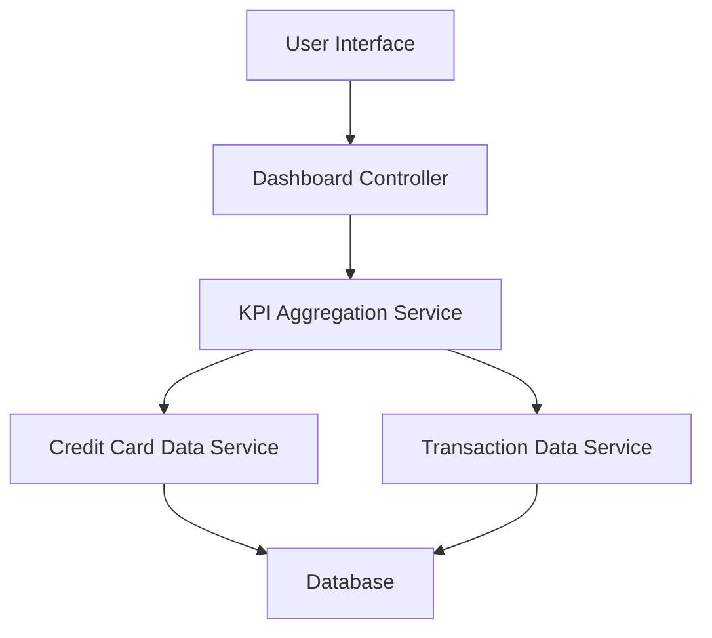

#### 1. High-Level Design

- **Summary**: This epic delivers a consolidated dashboard serving as the primary landing page and control center for credit card management. It provides users with a comprehensive view of all credit cards and key financial metrics (monthly spend, total credit limit, available credit, outstanding amounts) in a single interface, enabling quick assessment of financial position and informed credit usage decisions.

- **Component Flow**:

- **Integration Points**: 
  - **Upstream**: Credit Card Data Service (for retrieving card information and balances)
  - **Upstream**: Transaction Data Service (for calculating monthly spend metrics)
  - **Downstream**: Database (for card and transaction data storage)

- **Key Assumptions**: 
  - Monthly spend is calculated based on current calendar month transactions
  - Available credit is computed as (Total Credit Limit - Outstanding Amount) for each card and aggregated

- **NFR Highlights**: Dashboard must load within 2 seconds; responsive design for mobile, tablet, and desktop devices; modern and intuitive UI; must handle display of multiple credit cards simultaneously

- **Data Flow**: User accesses dashboard (landing page) → Dashboard Controller initiates request → KPI Aggregation Service queries Credit Card Data Service for all user cards (card details, credit limits, outstanding balances) → Service queries Transaction Data Service for current month transactions → Database provides card and transaction data → KPI Aggregation Service calculates total credit limit (sum across cards), available credit (sum of available per card), outstanding amount (sum across cards), and monthly spend (sum of current month transactions) → Aggregated KPIs and individual card details returned to Dashboard Controller → UI renders consolidated dashboard with KPI widgets and multi-card overview in responsive layout → User views complete credit card portfolio at a glance

#### 2. Validation Report

- **Requirements Coverage**: The design fully addresses the epic's scope including all four KPI displays (monthly spend, total credit limit, available credit, outstanding amount), multiple credit card view and management, consolidated information display, and responsive dashboard layout. All NFRs are satisfied through the KPI Aggregation Service ensuring sub-2-second load times, responsive UI components supporting mobile/tablet/desktop devices, modern interface design, and efficient handling of multiple cards through optimized data aggregation. The architecture provides a clear separation of concerns with dedicated services for card data and transaction data, enabling the dashboard to serve effectively as the primary control center for credit card management.