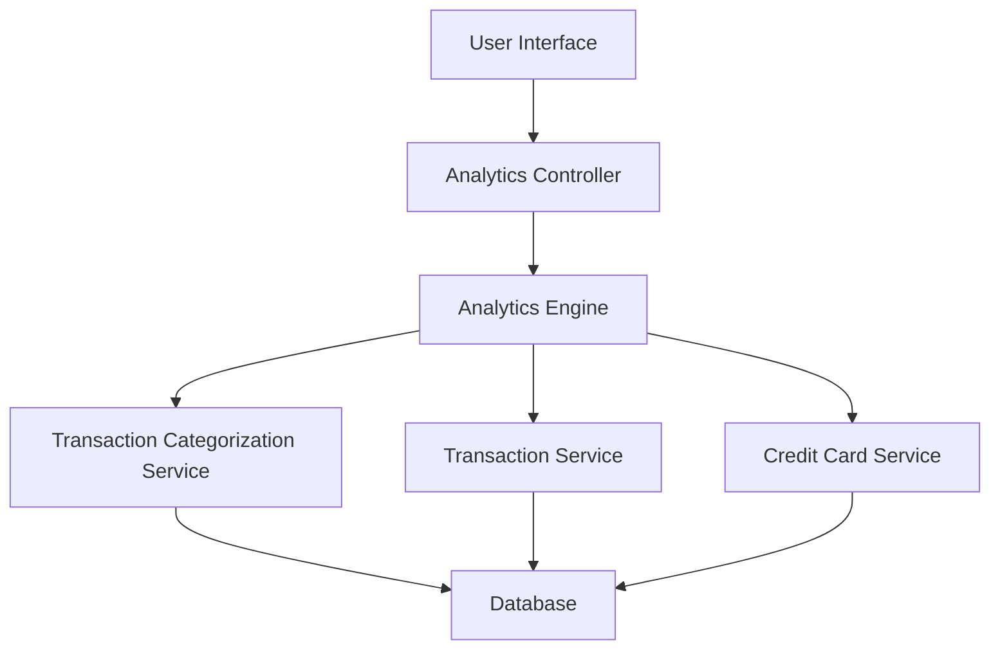

#### 1. High-Level Design

- **Summary**: This epic provides interactive analytics and visualization capabilities enabling users to understand spending patterns through category-wise analysis across nine predefined categories (Food & Dining, Fuel, Shopping, Travel, Entertainment, Utilities, Healthcare, Education, Miscellaneous), monthly trend analysis, and card-wise spend breakdowns with interactive charts and graphs.

- **Component Flow**:

- **Integration Points**: 
  - **Upstream**: Transaction Categorization Service (for classifying spending by category)
  - **Upstream**: Analytics Engine (for processing and aggregating spending data)
  - **Upstream**: Credit Card Service and Transaction Service (for source data)
  - **Downstream**: Database (for transaction and card data)

- **Key Assumptions**: 
  - Transactions are automatically categorized into one of nine predefined categories by the categorization service
  - Monthly trends are calculated based on transaction date with aggregation by calendar month

- **NFR Highlights**: Analytics visualizations must render within 2 seconds; charts must be interactive with drill-down capabilities; real-time data refresh support; responsive visualizations across different screen sizes

- **Data Flow**: User selects analytics view (category/monthly/card-wise) through UI → Analytics Controller receives request with time range and filters → Analytics Engine queries Transaction Categorization Service for category mappings → Engine aggregates data from Transaction Service and Credit Card Service → Database provides raw transaction and card data → Analytics Engine processes and calculates spending metrics, trends, and breakdowns → Processed analytics data returned to UI → Interactive charts and graphs rendered with drill-down capabilities → User can explore spending patterns across categories, time periods, and cards

#### 2. Validation Report

- **Requirements Coverage**: The design comprehensively covers all aspects of the epic including category-wise spending visualization across nine predefined categories, monthly spend trend analysis, card-wise spend analysis, interactive charts with drill-down capabilities, comparative analytics, and responsive interface. The architecture addresses all NFRs through the dedicated Analytics Engine for sub-2-second rendering, real-time data refresh capabilities, and responsive visualization components. The integration with Transaction Categorization Service ensures accurate category classification, while the Analytics Engine provides the processing power for aggregation and trend analysis.