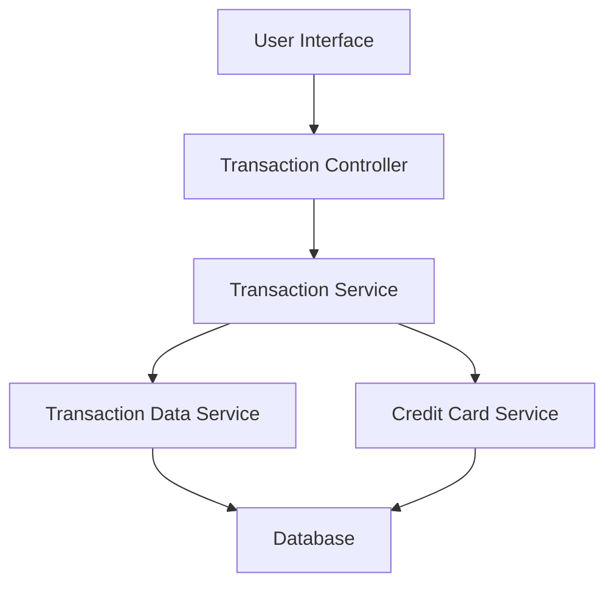

#### 1. High-Level Design

- **Summary**: This epic delivers a centralized transaction management interface enabling users to view, search, filter, and monitor all credit card transactions across multiple cards. The system provides comprehensive transaction history with detailed views, helping users maintain transparency and control over their credit card spending patterns.

- **Component Flow**:

- **Integration Points**: 
  - **Upstream**: Transaction Data Service (for retrieving transaction records)
  - **Upstream**: Credit Card Service (for mapping transactions to specific cards)
  - **Downstream**: Database (for transaction storage and retrieval)

- **Key Assumptions**: 
  - Transaction data is pre-categorized and available through the transaction data service API
  - Pagination will use standard offset/limit approach with default page size of 50 transactions

- **NFR Highlights**: Transaction list must load within 3 seconds; pagination required for large volumes; search/filter operations must complete within 1 second; responsive design across all device types

- **Data Flow**: User requests transaction data through the UI → Transaction Controller receives request with filters/search parameters → Transaction Service queries Transaction Data Service and Credit Card Service → Services retrieve transaction records from Database with card mapping → Aggregated transaction data returned through service layers → UI renders paginated transaction list with search/filter capabilities → User can drill down into individual transaction details

#### 2. Validation Report

- **Requirements Coverage**: The design fully covers the epic's stated scope including transaction listing, multi-card view, search and filtering capabilities, transaction details view, history tracking, and responsive interface. All NFRs are addressed through the layered architecture with dedicated services for transaction retrieval, card mapping, and pagination support. The component flow ensures sub-3-second load times through efficient data service integration and sub-1-second search/filter operations through optimized query mechanisms.