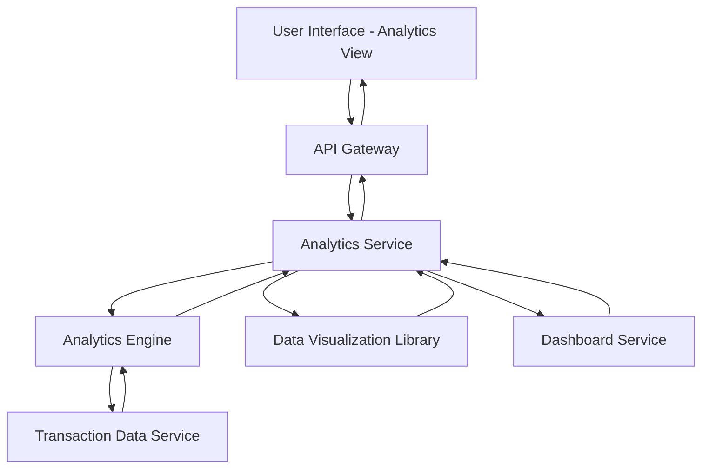

#### 1. High-Level Design

- **Summary**: This epic delivers interactive data visualizations and analytical capabilities that enable users to understand spending patterns through category-wise analysis and monthly trend tracking. The analytics module covers nine spending categories (Food & Dining, Fuel, Shopping, Travel, Entertainment, Utilities, Healthcare, Education, Miscellaneous) and provides card-wise spend breakdowns to support informed financial decision-making.

- **Component Flow**:

- **Integration Points**: 
  - **Upstream**: Dashboard Service (for integration with overall dashboard context and navigation)
  - **Internal**: Transaction Data Service (source of transaction data with category tags), Analytics Engine (performs data aggregation and pattern analysis), Data Visualization Library (renders charts and graphs)
  - **Downstream**: None explicitly mentioned

- **Key Assumptions**: 
  - Transactions are pre-categorized into the nine spending categories by upstream systems or a classification service (categorization logic not specified in epic)
  - Analytics data is aggregated and cached periodically to meet the sub-1-second visualization rendering requirement

- **NFR Highlights**: Visualization rendering time under 1 second; Support for interactive data exploration; Data aggregation for multiple time periods and categories

- **Data Flow**: User accesses the analytics view from the dashboard. The Analytics Service receives the request via API Gateway and invokes the Analytics Engine to compute spending insights. The Analytics Engine queries the Transaction Data Service for transaction data with category information, then performs aggregations across the nine spending categories, time periods (monthly trends), and cards. Aggregated data is returned to the Analytics Service, which formats it for visualization. The Data Visualization Library generates interactive charts and graphs (category-wise spending, monthly trends, card-wise analysis). The Analytics Service coordinates with the Dashboard Service to ensure consistent context and navigation, then sends the rendered visualizations to the User Interface. Users can interact with the visualizations (drill-down, filter by time period or card), triggering additional queries to the Analytics Engine for refined data.

#### 2. Validation Report

- **Requirements Coverage**: The design encompasses all scope items including category-wise spending visualization, monthly spend trend analysis, card-wise spend analysis, interactive charts and graphs, nine spending category tracking, spending pattern identification, and comparative spend analytics. The architecture supports the NFRs for sub-1-second visualization rendering (via data aggregation and caching), interactive data exploration (via the Data Visualization Library), and multi-period/multi-category data aggregation (via the Analytics Engine). All dependencies (Transaction data service, Analytics engine, Data visualization library, Dashboard service) are incorporated into the component flow. The design excludes out-of-scope items (real bank integration, payments, fund transfers, loans, payment gateway integration, predictive analytics, budget recommendations).