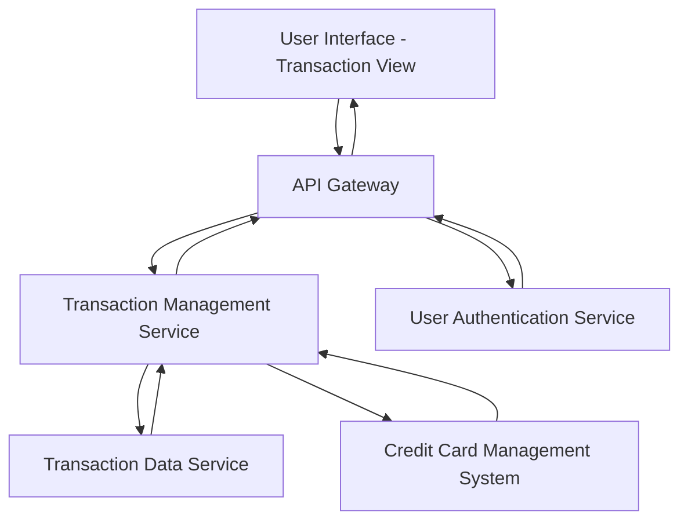

#### 1. High-Level Design

- **Summary**: This epic provides a unified interface for users to view, search, and filter transaction history across all their credit cards. Users can access detailed transaction information, segregate transactions by card, and track spending activities, enabling comprehensive transaction transparency and control.

- **Component Flow**:

- **Integration Points**: 
  - **Upstream**: User Authentication Service (for user identity and authorization), Credit Card Management System (for card ownership validation and card metadata)
  - **Internal**: Transaction Data Service (source of transaction records and historical data)
  - **Downstream**: None explicitly mentioned

- **Key Assumptions**: 
  - Transaction data is indexed by user ID and card ID to support sub-500ms retrieval response times
  - Historical transaction data retention period is defined by business policy (not specified in epic)

- **NFR Highlights**: Transaction retrieval response time under 500ms; Support for users with multiple credit cards; Historical transaction data storage capability

- **Data Flow**: User authenticates and navigates to the transaction view. The Transaction Management Service receives the request via API Gateway and validates user authorization through the User Authentication Service. The service queries the Credit Card Management System to retrieve the list of cards owned by the user, then requests transaction data from the Transaction Data Service for those cards. The Transaction Data Service retrieves historical transactions from storage, applies any user-specified filters (search criteria, date range, card selection), and returns the filtered transaction list. The Transaction Management Service aggregates and formats the data, including card-wise segregation, and sends it to the User Interface for display. Users can drill down into transaction details, which triggers additional detail retrieval from the Transaction Data Service.

#### 2. Validation Report

- **Requirements Coverage**: The design addresses all scope elements including transaction listing and display, multi-card transaction aggregation, transaction search and filtering, transaction detail view, transaction history access, and card-wise transaction segregation. The architecture supports the NFRs for handling multiple credit cards, sub-500ms retrieval response time (via indexed data access), and historical data storage. All dependencies (Transaction data service, Credit card management system, User authentication service) are integrated into the component flow. The design respects out-of-scope boundaries (real bank integration, payments, fund transfers, loans, payment gateway integration).