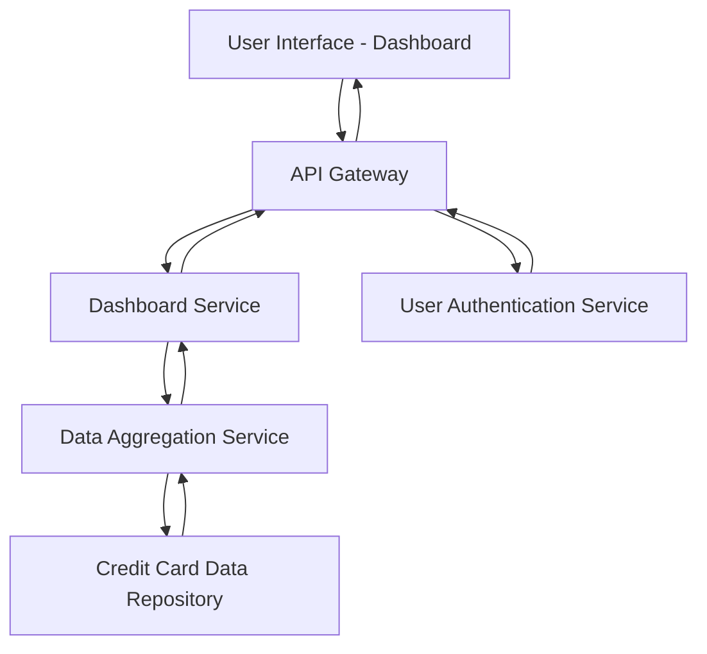

#### 1. High-Level Design

- **Summary**: This epic delivers a responsive dashboard interface that aggregates and displays key performance indicators for all user credit cards, including monthly spend, total credit limit, available credit, and outstanding amounts. The dashboard serves as the primary entry point for users to monitor their credit card portfolio health in real-time.

- **Component Flow**:

- **Integration Points**: 
  - **Upstream**: User Authentication Service (for user identity verification and session management)
  - **Internal**: Credit Card Data Repository (source of credit card master data and balances), Data Aggregation Service (computes KPIs from raw data)
  - **Downstream**: None explicitly mentioned

- **Key Assumptions**: 
  - Credit card data is updated in near real-time or at defined intervals to support the 2-second dashboard load requirement
  - KPI calculations (monthly spend, available credit) are pre-computed or cached by the Data Aggregation Service rather than computed on-demand

- **NFR Highlights**: Responsive design across mobile, tablet, and desktop devices; Dashboard load time under 2 seconds; Real-time data refresh capability

- **Data Flow**: User authenticates via User Authentication Service. Upon successful authentication, the Dashboard Service requests aggregated KPI data from the Data Aggregation Service, which queries the Credit Card Data Repository for all credit cards associated with the user. The repository returns card details, balances, and transaction summaries. The Data Aggregation Service computes monthly spend, total credit limit, available credit, and outstanding amounts, then returns consolidated KPIs to the Dashboard Service. The Dashboard Service formats the data and sends it via the API Gateway to the User Interface, which renders the responsive dashboard with all KPIs displayed.

#### 2. Validation Report

- **Requirements Coverage**: The design covers all stated scope items including dashboard interface development, monthly spend calculation, total credit limit aggregation, available credit computation, outstanding amount tracking, responsive layout implementation, and multiple credit card view. The architecture supports the NFRs for responsive design, sub-2-second load time (via data aggregation and caching), and real-time refresh. All identified dependencies (Credit card data repository, User authentication service, Data aggregation service) are incorporated into the component flow. The design explicitly excludes out-of-scope items (real bank integration, payments, fund transfers, loans, payment gateway integration).