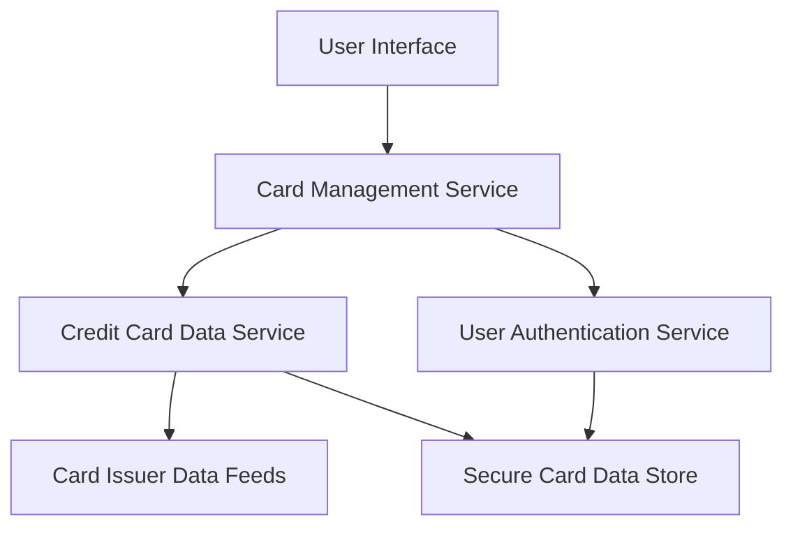

#### 1. High-Level Design

- **Summary:** This epic enables users to manage and view multiple credit cards within a unified interface. The core requirement is to display all user credit cards with relevant details, support card selection and switching, and provide access to card-specific information including card-wise spend analysis. The system must support at least 10 credit cards per user, retrieve card data with latency under 500ms, and ensure secure storage and display of card information.

- **Component Flow:**

- **Integration Points:**
  - **Upstream:** Credit Card Data Service (provides card details and balances)
  - **Upstream:** User Authentication Service (ensures secure access to card information)
  - **Upstream:** Card Issuer Data Feeds (supplies card information from issuers)
  - **Downstream:** User Interface (displays card list and card-specific details)

- **Key Assumptions:** 
  - Card data is cached or indexed to meet the 500ms retrieval latency requirement for users with up to 10 cards.
  - Secure storage includes encryption at rest and in transit, with appropriate access controls enforced by the User Authentication Service.

- **NFR Highlights:** Support for at least 10 credit cards per user; card data retrieval latency under 500ms; secure storage and display of card information.

- **Data Flow:** When a user accesses the multi-card interface, the User Interface sends a request to the Card Management Service. The service first validates the user's identity via the User Authentication Service to ensure secure access. Once authenticated, the Card Management Service queries the Credit Card Data Service to retrieve details for all cards associated with the user. The Credit Card Data Service fetches card information from Card Issuer Data Feeds and the Secure Card Data Store. The aggregated card data (including card details, balances, and card-wise spend analysis) is returned to the Card Management Service, which formats and sends it to the User Interface. The UI displays all cards in a listing interface, allowing users to select and switch between cards to view individual card details and card-specific spending information.

#### 2. Validation Report

- **Requirements Coverage:** The design fully addresses all scope items: multiple credit card display, card listing interface, card selection and switching, card-wise spend analysis, and individual card details view. All NFRs are covered: support for 10+ cards per user, sub-500ms card data retrieval latency, and secure storage/display of card information. Integration dependencies with Credit Card Data Service, User Authentication Service, and Card Issuer Data Feeds are incorporated. Out-of-scope items (real bank integration, card payments, adding new physical cards, card activation/deactivation) are explicitly excluded from the design.