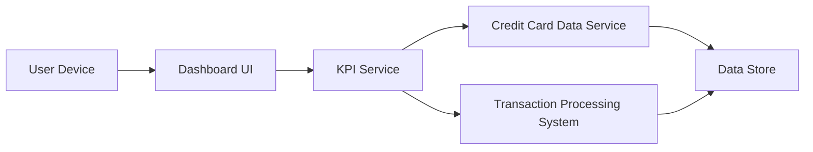

#### 1. High-Level Design

- **Summary:** This epic delivers a consolidated dashboard that displays key performance indicators (KPIs) for a user's credit card portfolio. The core requirement is to provide real-time visibility into critical financial metrics: monthly spend, total credit limit, available credit, and outstanding amounts across all credit cards. The dashboard must be responsive across all device types (mobile, tablet, desktop), refresh KPI data in real-time, and load within 2 seconds.

- **Component Flow:**

- **Integration Points:**
  - **Upstream:** Credit Card Data Service (retrieves card information, balances, credit limits)
  - **Upstream:** Transaction Processing System (calculates monthly spend)
  - **Downstream:** Dashboard UI (displays consolidated KPIs to users across devices)

- **Key Assumptions:** 
  - Credit Card Data Service provides aggregated data for all user cards in a single API call to meet the 2-second page load requirement.
  - Real-time data refresh is implemented via polling or WebSocket connections with appropriate caching strategies.

- **NFR Highlights:** Responsive design across all device types; real-time KPI data refresh; page load time under 2 seconds.

- **Data Flow:** When a user accesses the dashboard, the Dashboard UI sends a request to the KPI Service. The KPI Service orchestrates data retrieval by querying the Credit Card Data Service for card information (credit limits, available credit, outstanding amounts) and the Transaction Processing System for monthly spend calculations. Both services retrieve data from the Data Store. The KPI Service aggregates and consolidates metrics across all user credit cards, then returns the consolidated KPIs to the Dashboard UI. The UI renders the KPIs in a responsive layout optimized for the user's device (mobile, tablet, or desktop), providing real-time visibility into the user's credit card financial health.

#### 2. Validation Report

- **Requirements Coverage:** The design comprehensively covers all stated requirements: monthly spend display, total credit limit calculation, available credit tracking, outstanding amount monitoring, responsive dashboard layout, and multi-card consolidated view. All NFRs are addressed: responsive design across device types, real-time data refresh capability, and sub-2-second page load time. Integration dependencies with Credit Card Data Service and Transaction Processing System are incorporated. Out-of-scope items (real bank integration, card payments, fund transfers, loans, payment gateway integration) are explicitly excluded from the design.