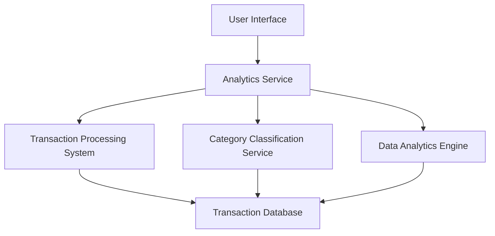

#### 1. High-Level Design

- **Summary:** This epic delivers comprehensive spending analytics and visualization capabilities for credit card users. The core requirement is to provide interactive visualizations showing category-wise spending breakdown across nine predefined categories (Food & Dining, Fuel, Shopping, Travel, Entertainment, Utilities, Healthcare, Education, Miscellaneous) and monthly spend trend analysis. The system must process at least 12 months of transaction history and support up to 10,000 transactions per user with visualization rendering under 1 second.

- **Component Flow:**

- **Integration Points:**
  - **Upstream:** Transaction processing system (provides raw transaction data)
  - **Upstream:** Category classification service (categorizes transactions into predefined categories)
  - **Upstream:** Data analytics engine (calculates trends and patterns)
  - **Downstream:** User Interface (consumes analytics data for visualization)

- **Key Assumptions:** 
  - Transaction data is pre-categorized by the Category Classification Service in real-time or near-real-time; historical transactions are already classified.
  - Monthly trend calculations are performed on-demand or cached periodically to meet the 1-second rendering requirement.

- **NFR Highlights:** Analytics must process and display 12+ months of transaction history; visualization rendering under 1 second; support for 10,000+ transactions per user.

- **Data Flow:** Raw transaction data flows from the Transaction Processing System into the Transaction Database. The Category Classification Service categorizes transactions into one of nine predefined categories. When a user requests analytics, the Analytics Service queries the Transaction Database, retrieves categorized transactions, and leverages the Data Analytics Engine to calculate category-wise breakdowns and monthly trends. The processed analytics data is then rendered as interactive visualizations (charts and graphs) in the User Interface, enabling users to explore spending patterns across categories and time periods.

#### 2. Validation Report

- **Requirements Coverage:** The design fully covers the epic's stated scope including category-wise spending visualization (9 predefined categories), monthly spend trends, interactive charts, spending pattern analysis, and historical spending comparison. All NFRs are addressed: 12-month transaction history processing, sub-1-second visualization rendering, and support for 10,000+ transactions per user. Integration dependencies with Transaction Processing System, Category Classification Service, and Data Analytics Engine are incorporated. Out-of-scope items (real bank integration, predictive forecasts, budget alerts, custom categories, export) are explicitly excluded from the design.