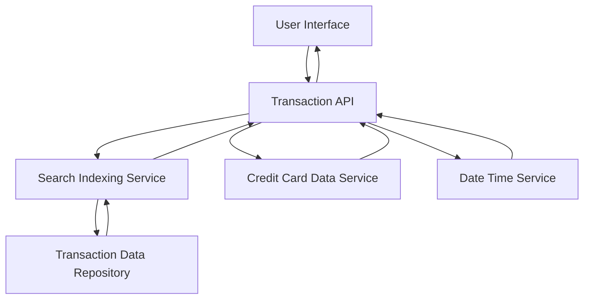

#### 1. High-Level Design

- **Summary:** This epic enables users to view, search, and analyze credit card transactions across all registered cards. It provides detailed transaction histories with filtering capabilities by date range, card, and category, displaying comprehensive transaction details including merchant name, amount, date, and category assignment. This serves as the foundation for expense tracking and financial record maintenance.

- **Component Flow:**

- **Integration Points:**
  - **Upstream:** Transaction data repository/database for storing and retrieving transaction records
  - **Internal:** Credit card data service for linking transactions to specific cards
  - **Internal:** Date/time service for accurate timestamp management
  - **Internal:** Search indexing service for efficient transaction queries and filtering

- **Key Assumptions:**
  - Transaction data includes merchant name, amount, date, and pre-assigned category fields in the database schema.
  - Pagination is implemented with a default page size (e.g., 50 transactions per page) to handle large transaction sets efficiently.

- **NFR Highlights:** Transaction queries must return results within 1 second for up to 10,000 transactions, system must support pagination for large transaction sets, transaction data must be encrypted at rest and in transit, and audit trail must be maintained for all transaction views.

- **Data Flow:** User accesses transaction management interface → User applies filters (date range, card, category) → Transaction API receives query with filter parameters → Transaction API validates date range via Date/Time Service → Transaction API queries Search Indexing Service with filter criteria → Search Indexing Service performs indexed search on Transaction Data Repository → Transaction Data Repository returns matching transaction records (paginated) → Transaction API enriches results with card details from Credit Card Data Service → Transaction API logs access to audit trail → Transaction API returns paginated transaction list with details → User Interface displays transactions with merchant name, amount, date, category → User views and navigates through transaction history.

#### 2. Validation Report

- **Requirements Coverage:** The design fully addresses all scope requirements including transaction listing, search and filtering, transaction details display, date range filtering, card-wise filtering, transaction history access, and category assignment per transaction. All NFRs (1-second query response for 10,000 transactions, pagination support, encryption at rest and in transit, audit trail maintenance) are incorporated through appropriate architectural components. All dependencies (transaction data repository, credit card data service, date/time service, search indexing service) are explicitly included in the component flow and data flow descriptions.