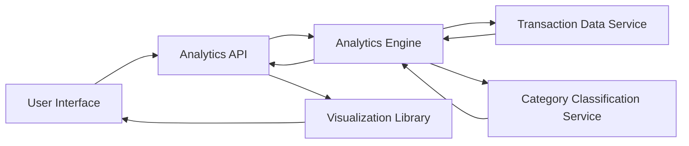

#### 1. High-Level Design

- **Summary:** This epic delivers interactive analytics and visualization capabilities that enable users to understand spending patterns across categories and time periods. It provides monthly spend trends, card-wise spending distribution, and category-wise breakdowns across nine predefined categories (Food & Dining, Fuel, Shopping, Travel, Entertainment, Utilities, Healthcare, Education, Miscellaneous) through interactive charts, graphs, and trend lines.

- **Component Flow:**

- **Integration Points:**
  - **Upstream:** Transaction data service for raw spending data
  - **Internal:** Analytics engine for data aggregation and computation
  - **Internal:** Category classification service for assigning transactions to spending categories
  - **Frontend:** Visualization library for rendering charts and graphs

- **Key Assumptions:**
  - Transactions are pre-categorized or the category classification service uses rule-based logic (merchant codes/names) to assign categories.
  - Monthly trends are calculated based on transaction dates aggregated by calendar month, with the current month showing partial data.

- **NFR Highlights:** Analytics queries must complete within 3 seconds for up to 12 months of data, visualizations must render smoothly on all supported devices, system must support concurrent analytics requests from multiple users, and data aggregation must be accurate to two decimal places.

- **Data Flow:** User selects analytics view (monthly trends, card-wise, or category-wise) → Analytics API receives request → Analytics Engine queries Transaction Data Service for relevant transaction data → Transaction Data Service returns raw transaction records → Analytics Engine sends transactions to Category Classification Service for categorization → Category Classification Service returns categorized transactions → Analytics Engine aggregates data by selected dimension (time, card, category) and calculates totals/trends → Analytics API returns aggregated results → Visualization Library renders interactive charts/graphs → User views and interacts with spending insights.

#### 2. Validation Report

- **Requirements Coverage:** The design comprehensively covers all scope elements including monthly spend trends visualization, card-wise spend analysis, category-wise spending breakdown (all nine categories), interactive charts/graphs, and spending pattern identification. All NFRs (3-second query time for 12 months, smooth rendering, concurrent user support, two-decimal accuracy) are addressed through the analytics engine and visualization components. All dependencies (transaction data service, analytics engine, visualization library, category classification service) are incorporated into the architecture.