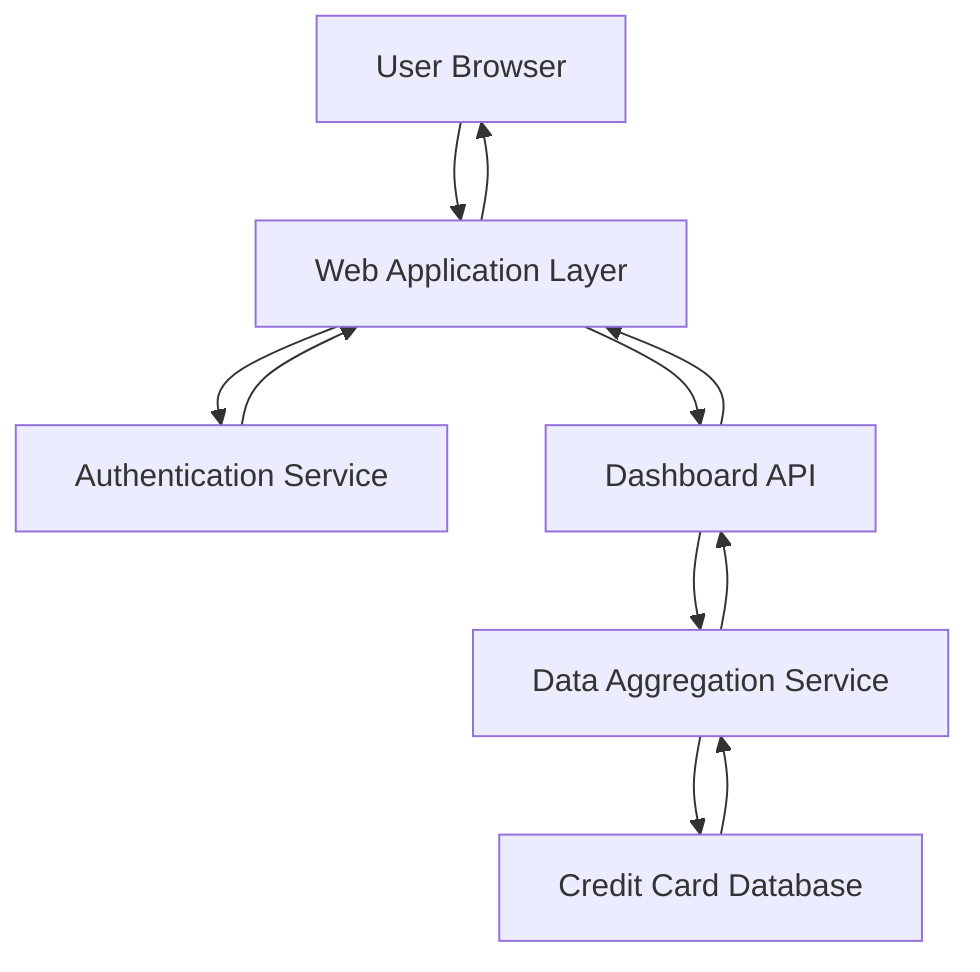

#### 1. High-Level Design

- **Summary:** This epic delivers a consolidated, responsive dashboard that provides real-time visibility into the user's credit card portfolio. It displays key performance indicators (KPIs) such as monthly spend, total credit limit, available credit, and outstanding amounts across multiple credit cards in a single interface, enabling users to monitor their overall credit health and financial position.

- **Component Flow:**

- **Integration Points:**
  - **Upstream:** User authentication service for secure access control
  - **Downstream:** Credit card data source/database for retrieving card information
  - **Internal:** Data aggregation service for consolidating multi-card information

- **Key Assumptions:**
  - Credit card data is assumed to be pre-populated in the database with standardized schema (card number, limit, balance, transactions).
  - Real-time data refresh is interpreted as near real-time (within 5-10 seconds) rather than true streaming updates.

- **NFR Highlights:** Dashboard must load within 2 seconds, support responsive design (desktop/tablet/mobile), provide real-time or near real-time data refresh, and comply with WCAG 2.1 accessibility standards.

- **Data Flow:** User authenticates via the authentication service → Web application requests dashboard data from Dashboard API → Dashboard API calls Data Aggregation Service → Data Aggregation Service queries Credit Card Database for all user's cards → Database returns card details (limits, balances, outstanding amounts, monthly spend) → Data Aggregation Service consolidates and calculates KPIs → Dashboard API returns aggregated data → Web application renders responsive dashboard with KPIs → User views consolidated credit card portfolio.

#### 2. Validation Report

- **Requirements Coverage:** The design fully covers the epic's stated scope including monthly spend tracking, credit limit display, available credit calculation, outstanding amount monitoring, multiple credit card display, and responsive layout. All NFRs (2-second load time, responsive design, real-time refresh, WCAG 2.1 compliance) are addressed through appropriate architectural components. Dependencies on credit card data source, authentication service, and data aggregation service are explicitly incorporated into the component flow.