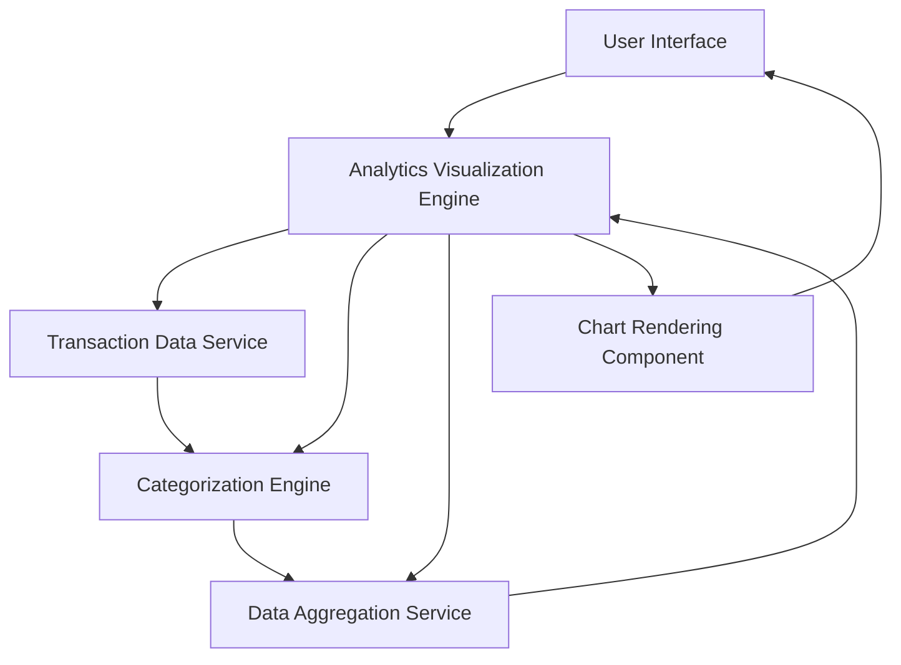

### 1. High-Level Design

**Summary:**  
This epic provides interactive visualizations and analytics to help users understand spending patterns across nine predefined categories (Food & Dining, Fuel, Shopping, Travel, Entertainment, Utilities, Healthcare, Education, Miscellaneous). Users can view monthly spend trends over at least 12 months and analyze category-wise spending through responsive, interactive charts.

**Component Flow:**

**Integration Points:**
- **Upstream:** Transaction Data Service (for raw transaction data)
- **Upstream:** Categorization Engine (for classifying transactions into spending categories)
- **Upstream:** Data Aggregation Service (for trend calculation and historical analysis)

**Key Assumptions:**
- Transactions are auto-categorized by the Categorization Engine using predefined rules; manual re-categorization is out of scope.
- Historical data is available for at least 12 months; data older than 12 months may not be displayed.

**NFR Highlights:**  
Analytics visualizations must render within 1.5 seconds; support historical data analysis for at least 12 months; charts must be interactive and responsive across all device types.

### 2. Validation Report

**Requirements Coverage:**  
The design comprehensively covers the epic's scope including category-wise spending visualization across all nine categories, monthly spend trends, interactive charts, and transaction categorization. The architecture supports the NFRs for performance (1.5-second rendering), historical data retention (12 months), and responsive design. All integration dependencies are identified and aligned with the stated requirements.