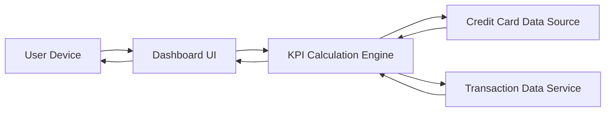

### 1. High-Level Design

**Summary:**  
This epic delivers a consolidated, responsive dashboard displaying critical financial KPIs: monthly spend, total credit limit, available credit, and outstanding amount. The dashboard provides real-time monitoring of overall credit card financial health across all devices (mobile, tablet, desktop).

**Component Flow:**

**Integration Points:**
- **Upstream:** Credit Card Data Source (for retrieving card details and credit limits)
- **Upstream:** Transaction Data Service (for calculating monthly spend and outstanding amounts)

**Key Assumptions:**
- KPI calculations are performed server-side and cached for performance; refresh interval is configurable (default: real-time on user action).
- "Monthly spend" refers to the current calendar month; no custom date range selection is included in this epic.

**NFR Highlights:**  
Dashboard must be responsive across mobile, tablet, and desktop devices; page load time under 2 seconds; support real-time data refresh for KPI metrics.

### 2. Validation Report

**Requirements Coverage:**  
The design fully addresses the epic's scope including all four KPIs (monthly spend, total credit limit, available credit, outstanding amount), responsive layout, and consolidated multi-card view. The architecture supports the NFRs for performance (sub-2-second load time) and responsiveness across devices. Integration dependencies align with the stated requirements.