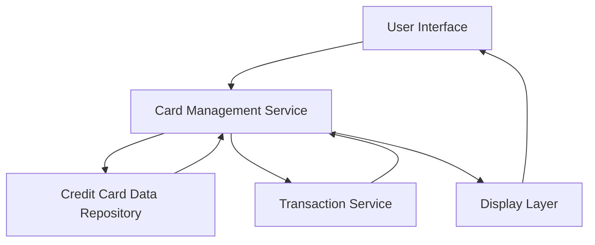

### 1. High-Level Design

**Summary:**  
This epic enables users to manage and view multiple credit cards (up to 10 per user) within a unified interface. Users can access consolidated views, perform card-wise spend analysis, compare card performance, and view individual card details including type, credit limit, current balance, and usage patterns.

**Component Flow:**

**Integration Points:**
- **Upstream:** Credit Card Data Repository (for card information retrieval)
- **Upstream:** Transaction Service (for card-wise spending data)

**Key Assumptions:**
- Card data is pre-populated in the repository; no real-time bank API integration is required.
- Card information masking follows standard PCI-DSS patterns (e.g., showing only last 4 digits).

**NFR Highlights:**  
System must support at least 10 credit cards per user; card data retrieval must complete within 1 second; secure display with appropriate masking.

### 2. Validation Report

**Requirements Coverage:**  
The design covers all stated scope including multiple card display, card-wise spend analysis, individual card details, comparison capabilities, and credit limit/balance tracking. The architecture supports the NFRs for performance (1-second retrieval) and security (data masking). Integration dependencies are clearly identified and aligned with the epic's requirements.