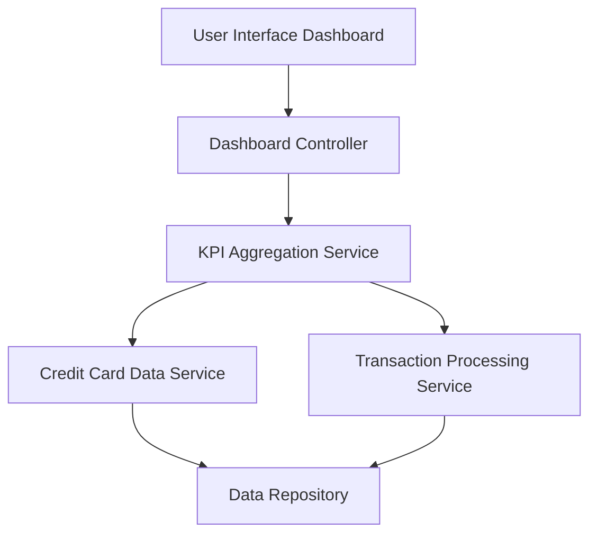

#### 1. High-Level Design

- **Summary:** This epic delivers a consolidated dashboard displaying key performance indicators for credit card management. The dashboard provides real-time visibility into monthly spend, total credit limit, available credit, and outstanding amounts across all credit cards in a unified interface, enabling users to assess their financial health and make informed decisions.

- **Component Flow:**

- **Integration Points:**
  - **Upstream:** Credit card data service (for retrieving card balances and limits), Transaction processing service (for calculating monthly spend and outstanding amounts)
  - **Downstream:** User interface layer for rendering dashboard visualizations

- **Key Assumptions:** 
  - Credit card data is provided in a standardized JSON format with fields for balance, limit, and transaction history
  - Real-time data refresh occurs via polling mechanism every 30-60 seconds or through event-driven updates

- **NFR Highlights:** Dashboard must load within 2 seconds, support responsive design across desktop and mobile devices, handle real-time data refresh for KPI metrics

#### 2. Validation Report

- **Requirements Coverage:** The design fully covers the epic's stated scope by incorporating all required KPI components (monthly spend, credit limit, available credit, outstanding amounts) through dedicated services and aggregation logic. The architecture supports the 2-second load time requirement through efficient service orchestration and the responsive design requirement through a dedicated UI layer. All integration dependencies are mapped to specific architectural components.