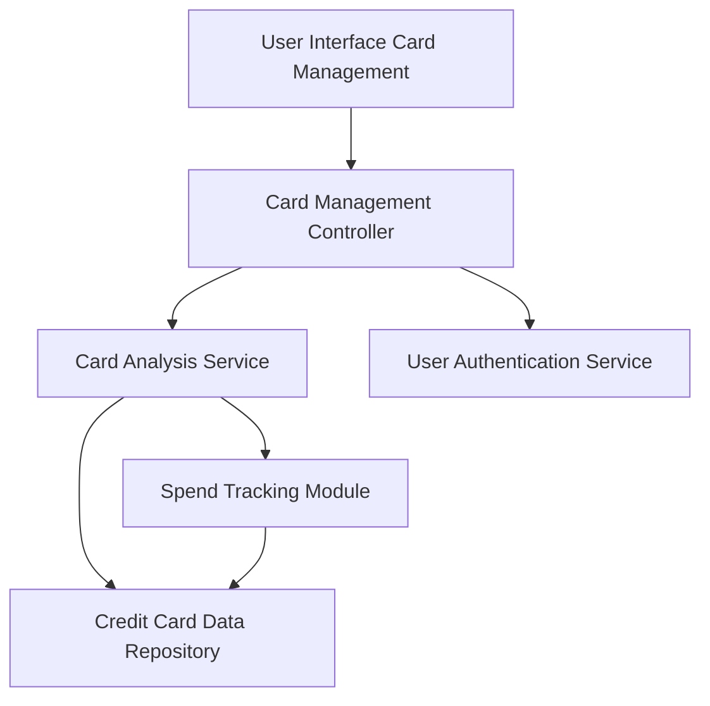

#### 1. High-Level Design

- **Summary:** This epic enables centralized management and monitoring of multiple credit cards. Users can view all cards with relevant details, track card-specific spending patterns, analyze usage across different cards, and compare performance and utilization across their credit card portfolio from a single interface.

- **Component Flow:**

- **Integration Points:**
  - **Upstream:** User authentication service (for card ownership validation), Credit card data repository (for storing and retrieving card information)
  - **Downstream:** Card management UI for displaying multi-card views and comparison interfaces

- **Key Assumptions:** 
  - Card data synchronization follows a delta-update pattern to minimize data transfer overhead
  - Card ownership is validated once per session with token-based authentication maintained throughout

- **NFR Highlights:** System must support management of up to 50 credit cards per user, card data synchronization must occur within 5 seconds, interface must maintain responsiveness with multiple cards loaded

#### 2. Validation Report

- **Requirements Coverage:** The design comprehensively addresses all functional requirements including multi-card display, card-wise spend analysis, card details visualization, and comparison capabilities through dedicated service components. The architecture supports the NFR of managing up to 50 cards per user through scalable repository design and the 5-second synchronization requirement through optimized data retrieval patterns. Authentication integration ensures proper card ownership validation as specified in dependencies.