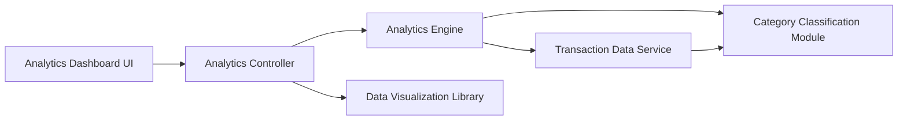

#### 1. High-Level Design

- **Summary:** This epic delivers comprehensive spending analytics through interactive visualizations enabling users to understand spending behavior. Users can analyze monthly spend trends over time and explore category-wise spending breakdowns across nine distinct categories (Food & Dining, Fuel, Shopping, Travel, Entertainment, Utilities, Healthcare, Education, Miscellaneous), providing actionable insights for budget optimization.

- **Component Flow:**

- **Integration Points:**
  - **Upstream:** Transaction data service (for retrieving categorized spending data), Analytics engine (for processing and aggregating spending patterns), Data visualization library (for rendering interactive charts)
  - **Downstream:** Analytics dashboard UI for presenting trends, charts, and category breakdowns with interactive filtering

- **Key Assumptions:** 
  - Transactions are pre-categorized into the nine specified categories by the transaction data service using rule-based or ML classification
  - Historical data is stored in an aggregated format (monthly summaries) to optimize the 3-second rendering requirement for 12 months of data

- **NFR Highlights:** Analytics visualizations must render within 3 seconds, support interactive filtering and drill-down capabilities, handle up to 12 months of historical transaction data efficiently

#### 2. Validation Report

- **Requirements Coverage:** The design fully addresses the epic's requirements by implementing all specified analytics capabilities including monthly trend visualization, nine-category spending analysis, and interactive charts through dedicated analytics and visualization components. The architecture supports the 3-second rendering NFR through pre-aggregated data structures and efficient analytics engine processing. The 12-month historical data handling requirement is met through optimized data retrieval and caching strategies. All integration dependencies are properly mapped to architectural components.