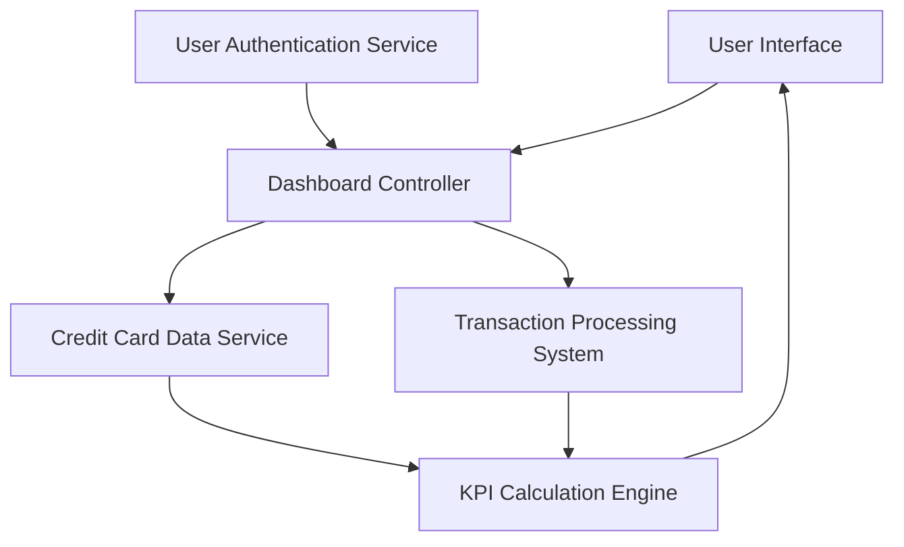

#### 1. High-Level Design

- **Summary:** This epic delivers a consolidated dashboard that aggregates and displays key financial metrics across all user credit cards in a single view. The system retrieves credit card data and transaction summaries, calculates KPIs (monthly spend, total credit limit, available credit, outstanding amounts, credit utilization), and presents them in a responsive interface with real-time data refresh capability.

- **Component Flow:**

- **Integration Points:**
  - **Upstream:** Credit Card Data Service (retrieves credit card information including credit limits and outstanding balances)
  - **Upstream:** Transaction Processing System (provides spend calculations and transaction summaries)
  - **Upstream:** User Authentication Service (ensures secure access to sensitive financial data)

- **Key Assumptions:**
  - Credit card data and transaction summaries are updated in near-real-time by backend systems; dashboard refresh interval is assumed to be configurable (e.g., every 30-60 seconds).
  - Credit utilization is calculated as (Outstanding Amount / Total Credit Limit) × 100%.

- **NFR Highlights:** Dashboard must load within 2 seconds; system must support real-time data refresh; interface must be responsive across desktop, tablet, and mobile devices; data accuracy must be 100% for all financial calculations.

- **Data Flow:** User logs in via User Authentication Service → Dashboard Controller requests credit card data from Credit Card Data Service and transaction summaries from Transaction Processing System → KPI Calculation Engine computes monthly spend, total credit limit, available credit, outstanding amounts, and credit utilization → Aggregated KPIs are displayed in the responsive User Interface → Dashboard supports real-time refresh to reflect updated financial data.

#### 2. Validation Report

- **Requirements Coverage:** The design fully satisfies the epic's scope including dashboard KPIs display, monthly spend tracking, total credit limit aggregation, available credit calculation, outstanding amount tracking, multiple credit card view, consolidated interface, and responsive layout. The architecture meets all NFRs: 2-second load time, real-time data refresh, responsive design across devices, and 100% data accuracy for financial calculations. Integration with Credit Card Data Service, Transaction Processing System, and User Authentication Service provides complete functionality and security. The design excludes all out-of-scope items (real bank integration, card payments, fund transfers, loans, payment gateway integration).