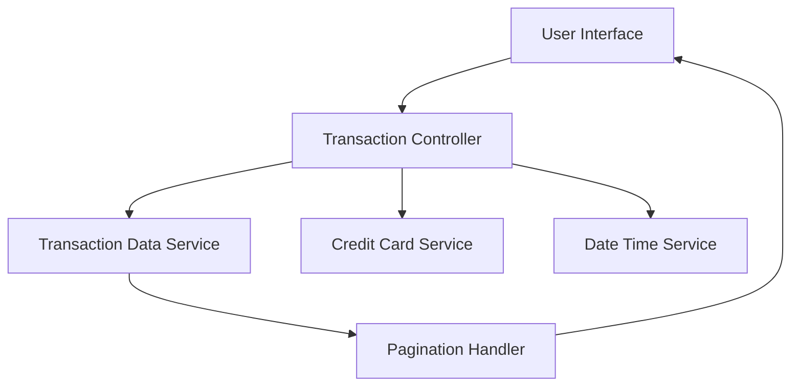

#### 1. High-Level Design

- **Summary:** This epic provides a centralized transaction monitoring interface that enables users to view, search, and filter transaction history across all their credit cards. The system retrieves transaction records from a backend service, applies user-specified filters, and displays detailed transaction information in a paginated, chronologically ordered list.

- **Component Flow:**

- **Integration Points:**
  - **Upstream:** Transaction Data Service (retrieves transaction records for display)
  - **Upstream:** Credit Card Service (provides card-specific filtering capabilities)
  - **Upstream:** Date/Time Service (ensures accurate transaction timestamps and chronological ordering)

- **Key Assumptions:**
  - Transaction data is stored and indexed by timestamp to support chronological ordering and efficient retrieval.
  - Pagination size is configurable; default page size is assumed to be 25-50 transactions per page.

- **NFR Highlights:** System must handle up to 10,000 transactions per user; transaction retrieval latency must be under 300ms; data must be displayed in chronological order with accurate timestamps; interface must support pagination for large transaction volumes.

- **Data Flow:** User accesses transaction monitoring interface → Transaction Controller requests transaction data from Transaction Data Service, optionally filtered by card (via Credit Card Service) → Date/Time Service ensures accurate timestamp formatting → Pagination Handler processes large result sets → Transaction list is displayed in chronological order in the User Interface → User can view transaction details, apply filters, and navigate through paginated results.

#### 2. Validation Report

- **Requirements Coverage:** The design comprehensively addresses the epic's scope including transaction listing, transaction details view, multi-card transaction aggregation, transaction history access, and responsive interface. The architecture supports all specified NFRs: handling 10,000 transactions per user, sub-300ms retrieval latency, chronological ordering with accurate timestamps, and pagination for large volumes. Integration with Transaction Data Service, Credit Card Service, and Date/Time Service ensures complete functionality. The design respects out-of-scope boundaries (no real bank integration, payments, fund transfers, loans, payment gateway integration, transaction disputes, or modifications).