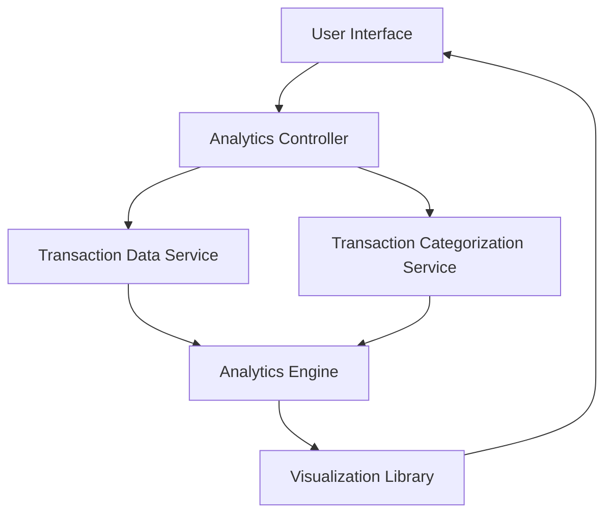

#### 1. High-Level Design

- **Summary:** This epic delivers an interactive analytics module that processes transaction data to generate spending insights across multiple dimensions (time-based trends, card-wise distribution, and category-wise breakdown). The system aggregates historical transaction data, applies categorization logic, and renders visualizations to help users understand spending patterns and make informed financial decisions.

- **Component Flow:**

- **Integration Points:**
  - **Upstream:** Transaction Data Service (provides historical transaction records for analysis)
  - **Upstream:** Transaction Categorization Service (assigns categories: Food & Dining, Fuel, Shopping, Travel, Entertainment, Utilities, Healthcare, Education, Miscellaneous)
  - **Internal:** Analytics Engine (performs data aggregation, trend calculation, and statistical analysis)
  - **Internal:** Visualization Library (renders interactive charts and graphs)

- **Key Assumptions:**
  - Transaction data is pre-categorized by the Transaction Categorization Service; re-categorization logic is not in scope for this epic.
  - Historical data retention is at least 12 months; data older than this may not be available for trend analysis.

- **NFR Highlights:** Analytics charts must render within 1.5 seconds; system must support interactive filtering and drill-down capabilities; visualizations must be responsive and mobile-friendly; data aggregation must handle at least 12 months of historical data.

- **Data Flow:** User requests spending analytics → Analytics Controller fetches transaction data from Transaction Data Service and category mappings from Transaction Categorization Service → Analytics Engine aggregates data by month, card, and category → Processed data is passed to Visualization Library → Interactive charts (monthly trends, card-wise breakdown, category distribution) are rendered in the User Interface → User interacts with filters and drill-down options to explore spending patterns.

#### 2. Validation Report

- **Requirements Coverage:** The design fully covers the epic's stated scope including monthly spend trends visualization, card-wise spend analysis, category-wise spending breakdown across all predefined categories, and interactive charts. The component architecture supports the required NFRs for rendering performance (1.5 seconds), interactivity, responsiveness, and handling 12 months of historical data. Integration with Transaction Categorization Service and Transaction Data Service ensures accurate category assignment and data retrieval. The design explicitly excludes out-of-scope items (real bank integration, predictive analytics, budget alerts, spending recommendations, export functionality, custom category creation).