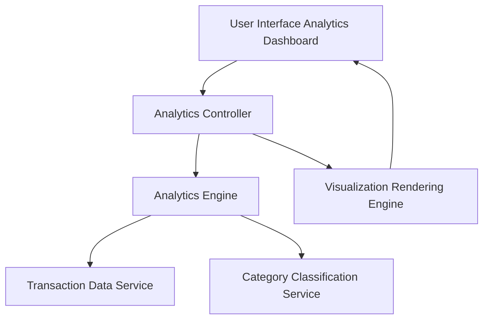

#### 1. High-Level Design

- **Summary:** This epic delivers interactive analytics and visualization capabilities that provide users with deep insights into spending patterns through category-wise breakdowns (Food & Dining, Fuel, Shopping, Travel, Entertainment, Utilities, Healthcare, Education, Miscellaneous), monthly spend trend analysis, and card-wise spend analysis. Interactive visualizations make complex spending data easily digestible and actionable.

- **Component Flow:**

- **Integration Points:** 
  - **Upstream:** Transaction data service with category classifications for retrieving categorized transaction data
  - **Upstream:** Analytics engine or calculation service for aggregating and analyzing spending data
  - **Downstream:** Visualization libraries (e.g., Chart.js, D3.js) for rendering interactive charts and graphs
  - **Downstream:** Responsive UI framework for displaying analytics across multiple device types

- **Key Assumptions:** 
  - Transactions are pre-classified into defined categories (Food & Dining, Fuel, Shopping, etc.) or a classification service exists to categorize transactions
  - Monthly trends are calculated based on calendar months; historical data is available for trend analysis (at least 6-12 months)

- **NFR Highlights:** Visualizations must render efficiently with large datasets; Analytics calculations must be accurate and consistent; Interactive charts must be responsive and support multiple device types

- **Data Flow:** User accesses the analytics dashboard, triggering the Analytics Controller to request spending insights from the Analytics Engine. The engine retrieves transaction data from the Transaction Data Service and applies category classifications via the Category Classification Service. The engine performs aggregations (category-wise totals, monthly trends, card-wise breakdowns) and returns structured data to the controller. The Visualization Rendering Engine transforms this data into interactive charts and graphs (pie charts for category breakdown, line charts for monthly trends, bar charts for card-wise analysis) and renders them in the UI. Users can interact with visualizations to drill down into specific categories, time periods, or cards.

#### 2. Validation Report

- **Requirements Coverage:** The high-level design fully addresses the epic's scope, including category-wise spending visualization for all nine specified categories (Food & Dining, Fuel, Shopping, Travel, Entertainment, Utilities, Healthcare, Education, Miscellaneous), monthly spend trend analysis, card-wise spend analysis, interactive charts and graphs, and spending pattern identification. All NFRs related to efficient rendering with large datasets, calculation accuracy, and responsive interactive charts are supported through dedicated architectural components (Analytics Engine, Visualization Rendering Engine). Integration dependencies with transaction data, category classifications, analytics engine, and visualization libraries are explicitly mapped in the component flow.