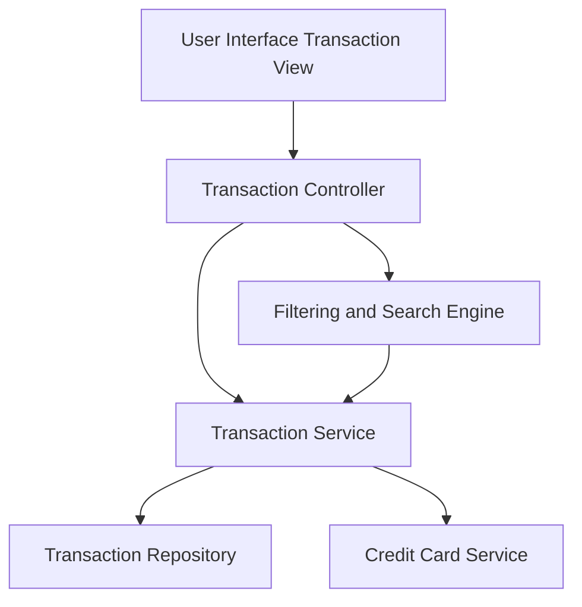

#### 1. High-Level Design

- **Summary:** This epic provides comprehensive transaction management functionality that enables users to view, track, and monitor all credit card transactions across multiple cards. Users can access detailed transaction histories, view individual transaction details, and understand spending behavior through comprehensive transaction data, supporting financial visibility and control.

- **Component Flow:**

- **Integration Points:** 
  - **Upstream:** Transaction data service or repository for retrieving transaction records
  - **Upstream:** Credit card data service to associate transactions with specific cards
  - **Downstream:** Responsive UI framework for displaying transaction lists and details across devices

- **Key Assumptions:** 
  - Transactions are stored with sufficient metadata (date, amount, merchant, category, card ID) to support filtering and search
  - Transaction history is retained for a defined period (e.g., 12-24 months) to support historical access

- **NFR Highlights:** System must handle large transaction volumes efficiently; Transaction data must be displayed accurately and consistently; Interface must maintain responsiveness with growing transaction history

- **Data Flow:** User accesses the transaction view interface, which sends requests to the Transaction Controller. The controller invokes the Transaction Service to retrieve transaction records from the Transaction Repository. The service also queries the Credit Card Service to associate each transaction with the correct credit card. If the user applies filters or search criteria, the Filtering and Search Engine processes the query and returns filtered results. Transaction data (including transaction ID, date, merchant, amount, category, card details) is returned to the UI for display in a responsive list or detail view.

#### 2. Validation Report

- **Requirements Coverage:** The high-level design comprehensively addresses the epic's scope, including transaction listing and display, transaction details view, multi-card transaction aggregation, transaction filtering and search, transaction history access, and responsive transaction interface. All NFRs regarding efficient handling of large transaction volumes, data accuracy, and interface responsiveness are supported through dedicated architectural components (Transaction Service, Filtering and Search Engine). Integration dependencies with transaction data service and credit card data are explicitly mapped.