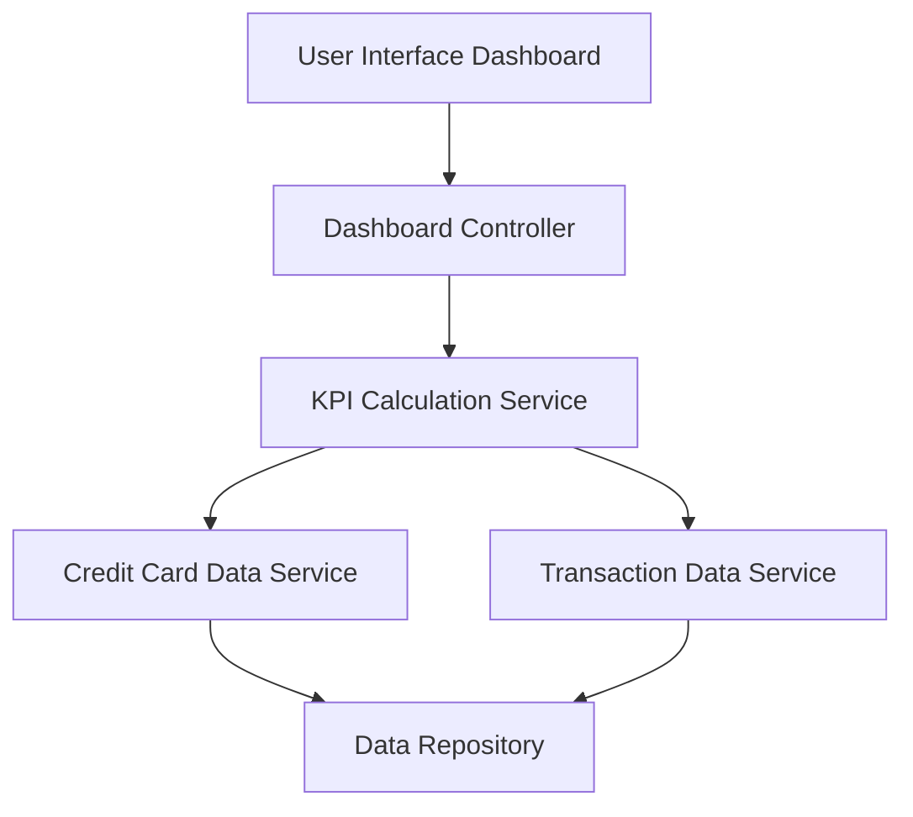

#### 1. High-Level Design

- **Summary:** This epic delivers a consolidated dashboard that displays key performance indicators for the user's credit card portfolio, including monthly spend, total credit limit, available credit, and outstanding amounts. The dashboard serves as the central hub for credit card management, providing real-time visibility into credit utilization and spending patterns across multiple cards.

- **Component Flow:**

- **Integration Points:** 
  - **Upstream:** Credit card data source for retrieving card details, balances, and credit limits
  - **Upstream:** Transaction data service for calculating monthly spend and outstanding amounts
  - **Downstream:** Responsive UI framework for rendering dashboard across desktop, tablet, and mobile devices

- **Key Assumptions:** 
  - Credit card data is available in a structured format with real-time or near-real-time updates
  - Monthly spend is calculated based on the current calendar month; outstanding amounts include all unpaid transactions

- **NFR Highlights:** System must support responsive layouts across desktop, tablet, and mobile devices; Dashboard must load and display KPIs within acceptable performance thresholds; Data accuracy for financial calculations must be maintained at 100%

- **Data Flow:** User accesses the dashboard interface, which triggers the Dashboard Controller to request KPI calculations from the KPI Calculation Service. The service retrieves credit card details (limits, balances) from the Credit Card Data Service and transaction data (monthly spend, outstanding amounts) from the Transaction Data Service. Both services query the Data Repository. The calculated KPIs (monthly spend, total credit limit, available credit, outstanding amounts) are aggregated and returned to the UI for display in a responsive layout.

#### 2. Validation Report

- **Requirements Coverage:** The high-level design fully covers the epic's stated scope, including dashboard interface, monthly spend calculation, credit limit aggregation, available credit computation, outstanding amount tracking, multiple credit card display, and responsive layout design. All NFRs related to responsiveness, performance, and data accuracy are addressed through appropriate architectural components. Integration dependencies with credit card data source and transaction data service are explicitly mapped in the component flow.