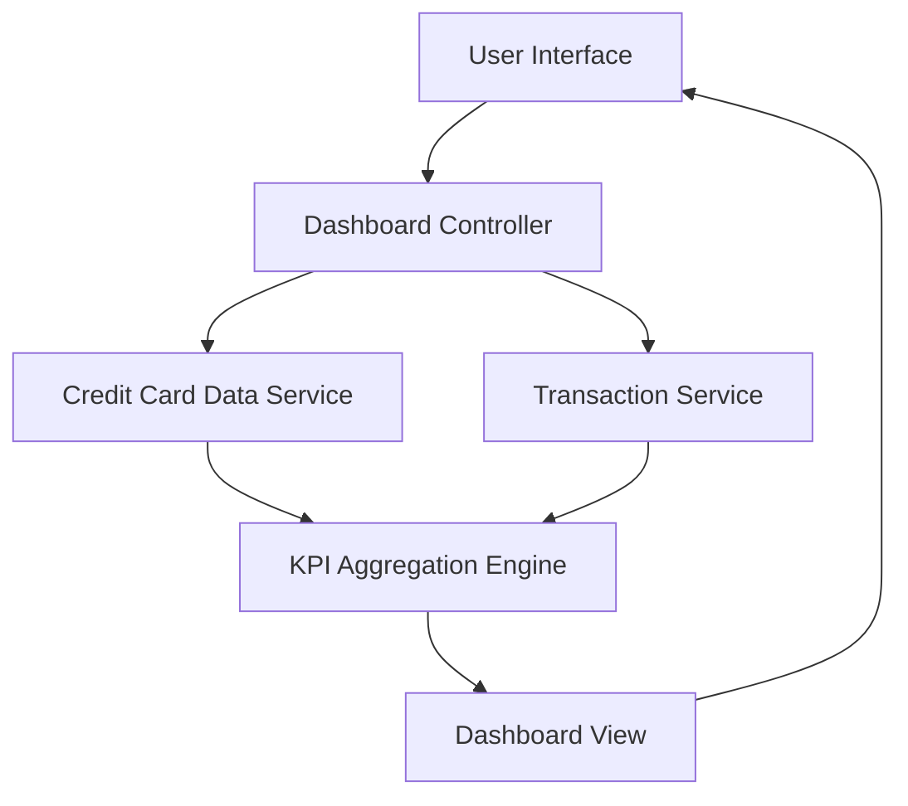

#### 1. High-Level Design

- **Summary:** This epic provides users with a comprehensive dashboard displaying key performance indicators (KPIs) for their credit card portfolio. Users can monitor critical financial metrics including monthly spend, total credit limit, available credit, and outstanding amounts in a consolidated, real-time view. The responsive dashboard design ensures accessibility across mobile and desktop devices, enabling informed decisions about spending and credit utilization.

- **Component Flow:**

- **Integration Points:**
  - **Upstream:** Credit Card Data Service (for retrieving card balances, credit limits, and available credit)
  - **Upstream:** Transaction Service (for calculating monthly spend and outstanding amounts)
  - **Internal:** KPI Aggregation Engine (for consolidating metrics across multiple cards and computing portfolio-level KPIs)

- **Key Assumptions:**
  - KPIs are calculated based on current month data; monthly spend resets at the beginning of each billing cycle.
  - Real-time data refresh is supported through periodic polling or event-driven updates; actual banking system integration is out of scope.

- **NFR Highlights:** Dashboard must load within 2 seconds, support responsive design for mobile and desktop devices, handle real-time data refresh for KPI updates.

#### 2. Validation Report

- **Requirements Coverage:** The design fully satisfies the epic's requirements including monthly spend display, total credit limit aggregation, available credit calculation, outstanding amount tracking, responsive dashboard layout, and KPI visualization. Dependencies on Credit Card Data Service and Transaction Service are properly integrated. The architecture meets all NFR requirements for performance (2-second load time), responsiveness (mobile and desktop support), and real-time data refresh capabilities.