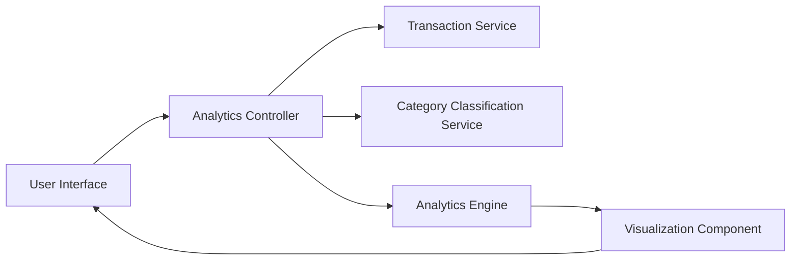

#### 1. High-Level Design

- **Summary:** This epic delivers interactive analytics and visualization capabilities to help users understand spending patterns and financial behavior. Users can view monthly spend trends over time and analyze expenses across 9 predefined categories (Food & Dining, Fuel, Shopping, Travel, Entertainment, Utilities, Healthcare, Education, Miscellaneous). Visual representations through charts and graphs enable data-driven budgeting and spending decisions.

- **Component Flow:**

- **Integration Points:**
  - **Upstream:** Transaction Service (for raw transaction data)
  - **Upstream:** Category Classification Service (for automatic transaction categorization into 9 predefined categories)
  - **Internal:** Analytics Engine (for trend calculation, aggregation, and pattern analysis)
  - **Frontend:** Visualization Component (for rendering interactive charts and graphs)

- **Key Assumptions:**
  - Transactions are automatically categorized by the Category Classification Service; manual recategorization is not supported.
  - Analytics calculations are performed on up to 12 months of historical transaction data; data older than 12 months is archived or excluded.

- **NFR Highlights:** Analytics visualizations must render within 3 seconds, support interactive filtering and drill-down capabilities, handle transaction data for up to 12 months of history.

#### 2. Validation Report

- **Requirements Coverage:** The design comprehensively addresses the epic's scope including category-wise spending visualization, monthly spend trends, interactive charts/graphs, spending pattern analysis across 9 categories, and transaction categorization. All dependencies on Transaction Service, Category Classification Service, and Analytics Engine are incorporated. The architecture supports the NFR requirements for performance (3-second render time), interactivity (filtering and drill-down), and data volume (12 months of history).