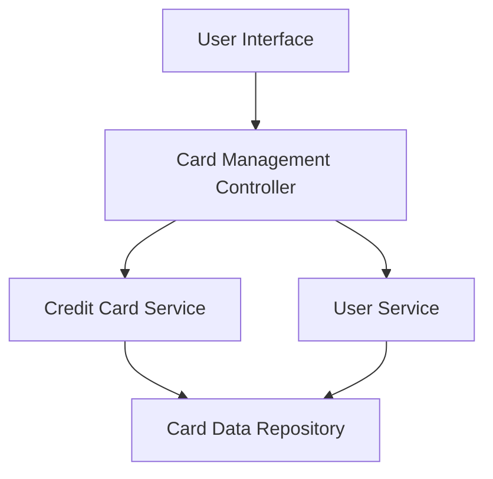

#### 1. High-Level Design

- **Summary:** This epic enables users to manage and monitor multiple credit cards from a single unified interface. The system consolidates all credit card information, providing card-specific details, spend analysis, and the ability to switch between cards. Users can view individual card metrics including credit limits, available credit, and outstanding balances for efficient multi-card management.

- **Component Flow:**

- **Integration Points:**
  - **Upstream:** User Service (for user account association and authentication)
  - **Downstream:** Credit Card Service (for retrieving card details, metadata, balances, and limits)
  - Card Data Repository (for persistent storage of card information)

- **Key Assumptions:**
  - Card data is pre-populated in the system; cards are already linked to user accounts via an administrative or onboarding process.
  - Card balance and limit data are refreshed periodically by backend services; real-time synchronization with external banking systems is out of scope.

- **NFR Highlights:** System must support at least 10 credit cards per user, card data retrieval latency under 300ms, ensure data isolation between user accounts.

#### 2. Validation Report

- **Requirements Coverage:** The design fully covers the epic's stated scope including multiple credit card display, card-wise spend analysis, individual card details view, card selection/switching, and card-specific tracking. All integration dependencies with Credit Card Service and User Service are addressed. The architecture supports the NFR requirements for scalability (10+ cards), performance (sub-300ms latency), and security (data isolation).