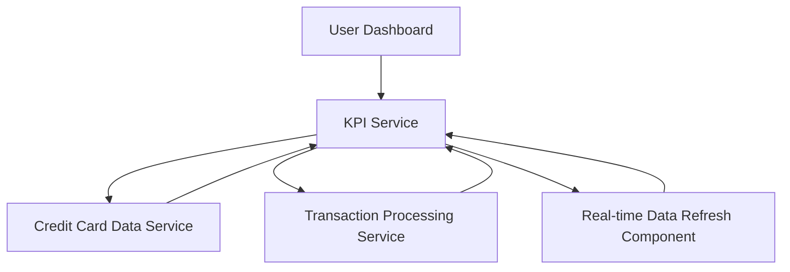

#### 1. High-Level Design

- **Summary:** This epic enables users to view a consolidated dashboard displaying key performance indicators for their credit card portfolio, including monthly spend, total credit limit, available credit, and outstanding amounts. Users can monitor multiple credit cards from a single interface with a modern, responsive design providing real-time visibility into their financial position across all cards.

- **Component Flow:**

- **Integration Points:**
  - **Upstream:** Credit Card Data Service (for retrieving card details and balances)
  - **Upstream:** Transaction Processing Service (for calculating monthly spend and outstanding amounts)

- **Key Assumptions:**
  - Real-time data refresh implemented via periodic polling (e.g., every 30 seconds) or WebSocket push notifications.
  - Multi-card KPI aggregation performed server-side; dashboard displays consolidated and per-card views.

- **NFR Highlights:** Responsive across desktop, tablet, mobile devices; real-time data refresh for KPI metrics; supports concurrent viewing of multiple credit cards without performance degradation.

- **Data Flow:** User accesses dashboard → KPI Service retrieves card details and balances from Credit Card Data Service → Transaction Processing Service calculates monthly spend and outstanding amounts → Real-time Data Refresh Component ensures up-to-date metrics → KPI Service aggregates data across multiple cards → Dashboard displays monthly spend, total credit limit, available credit, and outstanding amounts in responsive layout.

#### 2. Validation Report

- **Requirements Coverage:** The design comprehensively addresses all scope elements: dashboard KPI display for monthly spend, total credit limit, available credit, outstanding amount, multiple credit card view and management, and responsive layout for cross-device access. NFRs for responsive design across devices, real-time data refresh, and multi-card concurrent viewing without performance degradation are incorporated. Dependencies on credit card data service and transaction processing service are properly integrated.