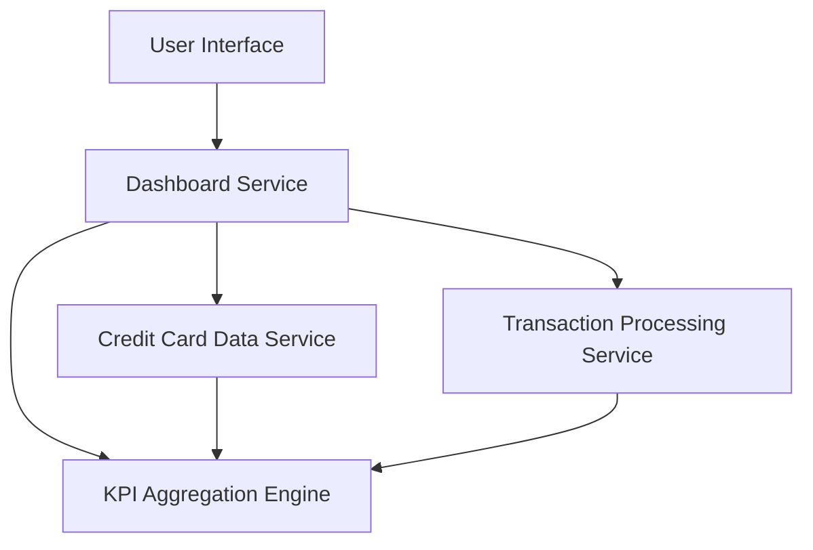

#### 1. High-Level Design

- **Summary:** This epic enables users to view a consolidated dashboard displaying key performance indicators for their credit card portfolio including monthly spend, total credit limit, available credit, and outstanding amounts. The dashboard provides real-time visibility into financial position across multiple credit cards through a modern, responsive design that adapts to desktop, tablet, and mobile devices.

- **Component Flow:**

- **Integration Points:**
  - **Upstream:** Credit Card Data Service (for retrieving card details, balances, and credit limits)
  - **Upstream:** Transaction Processing Service (for calculating monthly spend and outstanding amounts)
  - **Internal:** KPI Aggregation Engine (for consolidating metrics across multiple cards)

- **Key Assumptions:**
  - Card data and transaction data are available with sufficient freshness to support real-time KPI refresh.
  - Monthly spend is calculated based on the current calendar month; outstanding amounts reflect the most recent balance updates.

- **NFR Highlights:** Dashboard must be responsive across desktop, tablet, and mobile devices; real-time data refresh for KPI metrics; system must support concurrent viewing of multiple credit cards without performance degradation.

- **Data Flow:** User accesses the dashboard. The Dashboard Service retrieves all user-associated credit cards from the Credit Card Data Service and current transaction data from the Transaction Processing Service. The KPI Aggregation Engine calculates portfolio-level metrics: total credit limit (sum across all cards), available credit (sum of available credit per card), outstanding amount (sum of balances), and monthly spend (sum of current month transactions). Calculated KPIs are displayed in the UI with real-time refresh capability. The responsive layout adjusts to the user's device for optimal viewing experience.

#### 2. Validation Report

- **Requirements Coverage:** The design fully addresses the epic's scope including dashboard KPI display for monthly spend, total credit limit, available credit, outstanding amount, multiple credit card view and management, and responsive layout for cross-device access. The architecture supports the NFRs for responsiveness (desktop, tablet, mobile), real-time data refresh, and multi-card performance. Out-of-scope items (real bank integration, card payments, fund transfers, payment gateway integration) are excluded as specified in the epic.