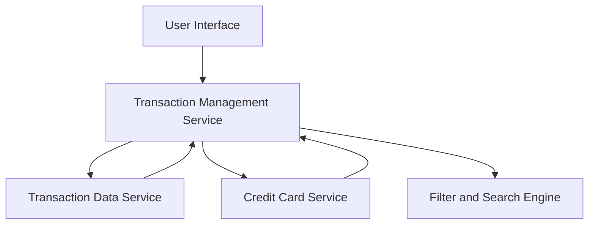

#### 1. High-Level Design

- **Summary:** This epic provides comprehensive transaction tracking capabilities, allowing users to view, filter, and analyze all credit card transactions across their portfolio. Users can access detailed transaction histories, verify charges, and understand spending behavior through transaction list views, detailed displays, and card-wise filtering.

- **Component Flow:**

- **Integration Points:**
  - **Upstream:** Transaction Data Service (for retrieving transaction records)
  - **Upstream:** Credit Card Service (for card-specific transaction filtering)

- **Key Assumptions:**
  - Transaction data retrieved via paginated API calls; filters applied server-side for performance.
  - Transaction history retained indefinitely or per regulatory requirements; card-wise filtering uses indexed queries.

- **NFR Highlights:** Transaction data must load within 2 seconds for standard queries; handle transaction history for multiple cards simultaneously; responsive design across all device sizes.

- **Data Flow:** User accesses transaction interface → Transaction Management Service retrieves transaction records from Transaction Data Service → User applies card-wise filters via Credit Card Service → Filter and Search Engine processes queries → Filtered transaction list displayed with details → User views individual transaction details for verification and analysis.

#### 2. Validation Report

- **Requirements Coverage:** The design fully covers the epic scope including transaction list view across all cards, transaction details display, card-wise transaction filtering, transaction history access, and responsive transaction interface. NFRs for 2-second load time, multi-card simultaneous handling, and responsive design are addressed. Dependencies on transaction data service and credit card service are properly integrated.