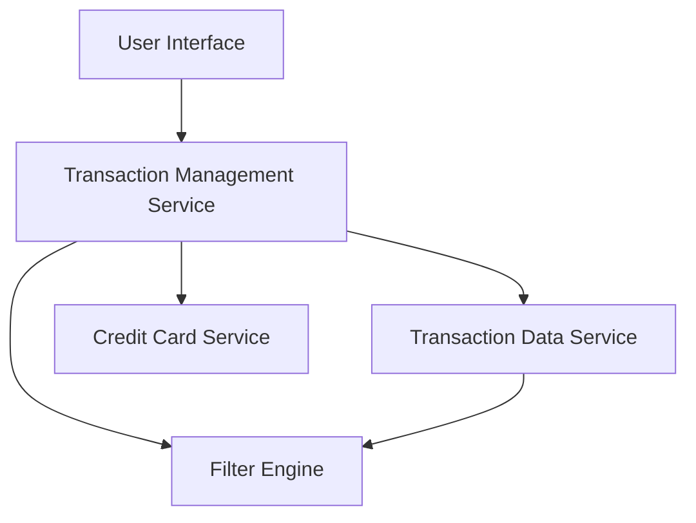

#### 1. High-Level Design

- **Summary:** This epic delivers comprehensive transaction tracking capabilities, enabling users to view, filter, and analyze all credit card transactions across their portfolio. Users can access detailed transaction histories, filter transactions by card, and verify charges to improve financial awareness and detect unauthorized activity. The interface is responsive and maintains usability across all device sizes.

- **Component Flow:**

- **Integration Points:**
  - **Upstream:** Transaction Data Service (for retrieving transaction records across all cards)
  - **Upstream:** Credit Card Service (for card-specific transaction filtering and card metadata)
  - **Internal:** Filter Engine (for applying user-selected filters and search criteria)

- **Key Assumptions:**
  - Transaction data is stored with sufficient detail (date, amount, merchant, category, card ID) to support filtering and detailed display.
  - Transaction history is retained for a reasonable period (e.g., 12-24 months) to enable historical analysis and verification.

- **NFR Highlights:** Transaction data must load within 2 seconds for standard queries; system must handle transaction history for multiple cards simultaneously; responsive design must maintain usability across all device sizes.

- **Data Flow:** User accesses the transaction management interface. The Transaction Management Service retrieves the user's credit cards from the Credit Card Service, then queries the Transaction Data Service to fetch transaction records for all or selected cards. The Filter Engine applies user-specified filters (date range, card, amount, merchant) to the transaction list. Filtered results are displayed in the UI with detailed transaction information (date, merchant, amount, category, card). Users can drill down into individual transactions for more details or adjust filters to refine the view.

#### 2. Validation Report

- **Requirements Coverage:** The design covers all stated requirements including transaction list view across all cards, transaction details display, card-wise transaction filtering, transaction history access, and responsive transaction interface. The architecture supports the NFRs for performance (2-second load time, multi-card simultaneous handling) and responsive design. Out-of-scope items (real bank integration, card payments, fund transfers, loans, payment gateway integration) are appropriately excluded from the design.