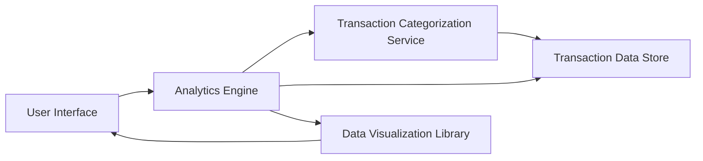

#### 1. High-Level Design

- **Summary:** This epic delivers interactive visualizations and analytical capabilities for understanding spending patterns through category-wise analysis, monthly spend trends, and card-wise spend breakdowns. Users explore spending across 9 predefined categories (Food & Dining, Fuel, Shopping, Travel, Entertainment, Utilities, Healthcare, Education, Miscellaneous) to identify trends and optimize spending behavior.

- **Component Flow:**

- **Integration Points:**
  - **Upstream:** Transaction Categorization Service (for mapping transactions to spending categories)
  - **Upstream:** Analytics Engine (for calculating trends and aggregations)
  - **Internal:** Data Visualization Library (for rendering interactive charts)

- **Key Assumptions:**
  - Transactions are categorized automatically using predefined rules or machine learning; category mappings stored with transactions.
  - Historical trend data pre-aggregated monthly for performance; drill-down queries executed on-demand.

- **NFR Highlights:** Analytics visualizations must render within 3 seconds; support real-time filtering and drill-down; handle historical data for trend analysis; responsive design across all device types.

- **Data Flow:** User accesses analytics dashboard → Analytics Engine retrieves categorized transactions from Transaction Data Store → Transaction Categorization Service ensures proper category mapping → Analytics Engine calculates category-wise spending, monthly trends, and card-wise breakdowns → Data Visualization Library renders interactive charts → User filters and drills down for deeper insights.

#### 2. Validation Report

- **Requirements Coverage:** The design comprehensively addresses the epic scope including category-wise spending visualization, monthly spend trend analysis, card-wise spend analysis, interactive charts, and spending breakdown across 9 predefined categories. NFRs for 3-second rendering, real-time filtering, drill-down capabilities, historical data handling, and responsive design are incorporated. Dependencies on transaction categorization service, analytics engine, and data visualization library are properly integrated.