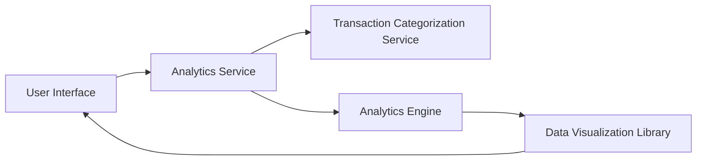

#### 1. High-Level Design

- **Summary:** This epic provides interactive visualizations and analytical capabilities for understanding spending patterns through category-wise analysis, monthly spend trends, and card-wise spend breakdowns. Users can explore spending across 9 predefined categories (Food & Dining, Fuel, Shopping, Travel, Entertainment, Utilities, Healthcare, Education, Miscellaneous) to identify trends and optimize spending behavior. The system supports real-time filtering and drill-down capabilities.

- **Component Flow:**

- **Integration Points:**
  - **Upstream:** Transaction Categorization Service (for mapping transactions to spending categories)
  - **Internal:** Analytics Engine (for calculating trends, aggregations, and card-wise breakdowns)
  - **Frontend:** Data Visualization Library (for rendering interactive charts with filtering and drill-down)

- **Key Assumptions:**
  - Transactions are automatically categorized by the Transaction Categorization Service into the 9 predefined categories.
  - Historical transaction data is available for trend analysis; the system assumes sufficient data retention for meaningful insights.

- **NFR Highlights:** Analytics visualizations must render within 3 seconds; interactive charts must support real-time filtering and drill-down capabilities; system must handle historical data for trend analysis; responsive design for analytics across all device types.

- **Data Flow:** User accesses the spending analytics interface. The Analytics Service retrieves categorized transaction data from the Transaction Categorization Service. The Analytics Engine processes this data to compute category-wise spending totals, monthly trends, and card-wise breakdowns. Results are passed to the Data Visualization Library, which renders interactive charts in the UI. Users can apply filters (time period, category, card) or drill down into specific data points, triggering real-time re-calculation and re-rendering of visualizations.

#### 2. Validation Report

- **Requirements Coverage:** The design addresses all requirements including category-wise spending visualization, monthly spend trend analysis, card-wise spend analysis, interactive charts and graphs, and spending breakdown by predefined categories. The architecture supports the NFRs for performance (3-second rendering), interactivity (real-time filtering and drill-down), historical data handling, and responsive design. Out-of-scope items (real bank integration, loans, payment gateway integration, fund transfers) are excluded as specified in the epic.