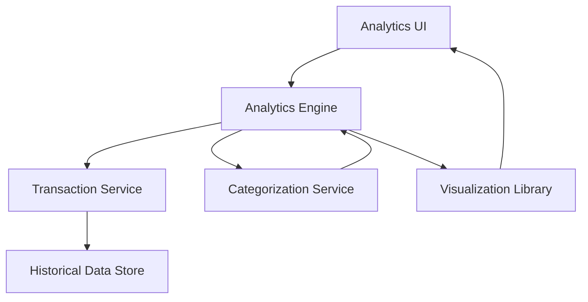

#### 1. High-Level Design

- **Summary:** This epic provides interactive analytics and visualization capabilities for understanding spending patterns through category-wise analysis and monthly trends. Users can explore spending across nine predefined categories (Food & Dining, Fuel, Shopping, Travel, Entertainment, Utilities, Healthcare, Education, Miscellaneous) with visual representations to identify trends and optimization opportunities, supporting at least 12 months of historical data.

- **Component Flow:**

- **Integration Points:** 
  - **Upstream:** Transaction service (for raw transaction data), Categorization engine/service (for assigning transactions to spending categories)
  - **Downstream:** Visualization libraries (for chart rendering), Historical data store (for 12+ months of transaction history)

- **Key Assumptions:** 
  - Transactions are automatically categorized by the categorization service using predefined rules or machine learning models.
  - Historical data store maintains at least 12 months of transaction history with efficient query capabilities for trend analysis.

- **NFR Highlights:** Analytics visualizations must be interactive and responsive; chart rendering optimized for large transaction datasets; system handles historical data analysis for at least 12 months.

- **Data Flow:** User requests spending analytics → Analytics Engine retrieves raw transaction data from Transaction Service → Transactions are processed through Categorization Service to assign to nine predefined categories → Engine aggregates spending by category and time period from Historical Data Store → Aggregated data formatted for visualization → Visualization Library renders interactive charts and graphs → Analytics UI displays category-wise spending breakdown, monthly trends, and insights → User interacts with visualizations to explore patterns and drill down into specific categories or time periods.

#### 2. Validation Report

- **Requirements Coverage:** The design fully addresses the epic's scope including category-wise spending visualization, monthly spend trend analysis, interactive charts and graphs, spending breakdown by nine predefined categories, transaction categorization, and trend identification. The architecture supports all NFR requirements: interactive and responsive visualizations, optimized chart rendering for large datasets, and historical data analysis for at least 12 months. All dependencies (transaction service, categorization engine, visualization libraries) are integrated. The component flow ensures efficient data processing from raw transactions through categorization to visual insights, empowering users with actionable spending behavior analysis.