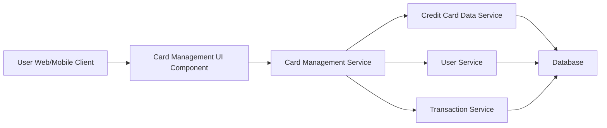

#### 1. High-Level Design

- **Summary:** This epic enables users to view and manage multiple credit cards from a single interface, providing card-wise spend analysis and monthly spend trends for each card. Users can monitor individual card performance, compare spending patterns across cards, and track card-specific metrics to optimize credit card usage strategy.

- **Component Flow:**

- **Integration Points:**
  - **Upstream:** Credit Card Data Service (provides card information and details)
  - **Upstream:** User Service (handles user authentication and card ownership validation)
  - **Upstream:** Transaction Service (provides card-wise spending data and monthly trends)
  - **Downstream:** Card Management UI Component displays multi-card view and individual card details

- **Key Assumptions:**
  - Card ownership validation occurs at service layer; user can only view cards they own.
  - Card data synchronization (within 5 seconds) implies periodic refresh; exact sync mechanism not specified.

- **NFR Highlights:** System must support minimum 10 credit cards per user, card data synchronization must occur within 5 seconds, responsive design for mobile and desktop.

- **Data Flow:** User accesses the card management interface via web or mobile client. The Card Management Service authenticates the user via User Service and validates card ownership. It retrieves card information from the Credit Card Data Service and card-wise spending data from the Transaction Service. The Card Management UI Component displays multiple credit cards with card-wise spend analysis and monthly spend trends, supporting card selection, filtering, and individual card detail views.

#### 2. Validation Report

- **Requirements Coverage:** The design covers all stated scope elements: multiple credit card display, card-wise spend analysis, monthly spend trends per card, card selection and filtering, and individual card detail views. The architecture supports the NFR of minimum 10 cards per user, 5-second data synchronization, and responsive design. Integration with Credit Card Data Service, User Service, and Transaction Service aligns with stated dependencies. Out-of-scope items (real bank integration, card payments, fund transfers, adding new physical cards, card application process) are explicitly excluded.