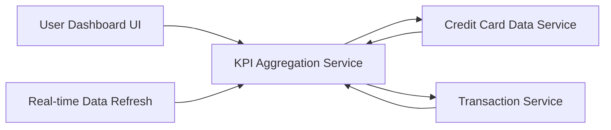

#### 1. High-Level Design

- **Summary:** This epic delivers a centralized, responsive dashboard displaying key performance indicators for credit card financial health. Users can view consolidated metrics including monthly spend, total credit limit, available credit, and outstanding amounts across all their cards in a single interface optimized for quick rendering.

- **Component Flow:**

- **Integration Points:** 
  - **Upstream:** Credit card data service (for card balances and limits), Transaction service (for monthly spend aggregates)
  - **Downstream:** Dashboard UI components (for rendering KPIs across devices)

- **Key Assumptions:** 
  - Near-real-time data refresh is achieved through periodic polling or event-driven updates from backend services.
  - KPI calculations (total credit limit, available credit, outstanding amounts) are aggregated server-side for performance.

- **NFR Highlights:** Dashboard must be responsive across desktop, tablet, and mobile devices; page load time optimized for quick KPI rendering; supports real-time or near-real-time data refresh.

- **Data Flow:** User accesses dashboard → KPI Aggregation Service requests current card balances and limits from Credit Card Data Service → Service requests monthly transaction totals from Transaction Service → Aggregation Service calculates consolidated KPIs (total credit limit, available credit, outstanding amounts, monthly spend) → Formatted KPI data returned to Dashboard UI → UI renders responsive, device-optimized view with real-time refresh capability.

#### 2. Validation Report

- **Requirements Coverage:** The design comprehensively addresses all KPI requirements specified in the epic: monthly spend display, total credit limit calculation, available credit tracking, outstanding amount visualization, responsive dashboard layout, and consolidated KPI view. The architecture supports the NFR requirements for responsive design across devices, optimized page load times, and real-time/near-real-time data refresh. All dependencies (credit card data service, transaction service) are integrated into the design. The component flow ensures efficient data aggregation and rendering for quick user access to financial health metrics.