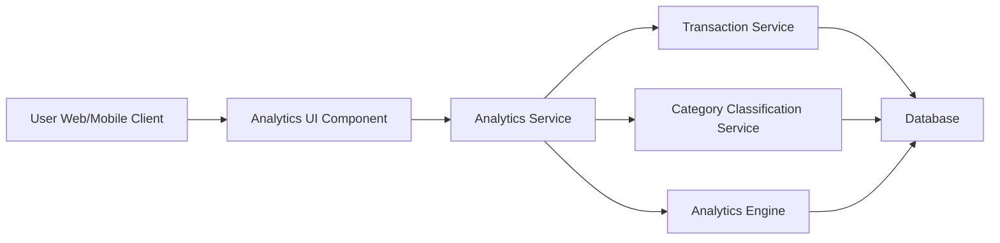

#### 1. High-Level Design

- **Summary:** This epic provides interactive visualizations and analytics for category-wise spending patterns across all credit cards. Users can analyze spending across nine predefined categories (Food & Dining, Fuel, Shopping, Travel, Entertainment, Utilities, Healthcare, Education, Miscellaneous) to identify trends, optimize budget allocation, and make data-driven financial decisions.

- **Component Flow:**

- **Integration Points:**
  - **Upstream:** Transaction Service (provides transaction data for analysis)
  - **Upstream:** Category Classification Service (categorizes transactions into nine predefined categories)
  - **Upstream:** Analytics Engine (performs data aggregation and trend analysis)
  - **Downstream:** Analytics UI Component renders interactive charts and visualizations

- **Key Assumptions:**
  - Category classification is automated (rule-based or ML-driven); manual re-categorization is out of scope.
  - Date range filtering defaults to last 12 months; exact default range not specified.

- **NFR Highlights:** Analytics visualizations must render within 3 seconds, support interactive filtering without page reload, handle minimum 12 months of transaction history.

- **Data Flow:** User accesses the analytics dashboard via web or mobile client. The Analytics Service retrieves transaction data from the Transaction Service, applies category classification via the Category Classification Service, and uses the Analytics Engine to aggregate spending by category and identify trends. The Analytics UI Component receives aggregated data and renders interactive charts and graphs, supporting filtering by date range without page reload.

#### 2. Validation Report

- **Requirements Coverage:** The design covers all stated scope elements: category-wise spending visualization, interactive charts and graphs, spending pattern analysis, nine predefined spending categories, trend identification, and filtering by date range. The architecture supports the 3-second rendering NFR and interactive filtering without page reload. Integration with Transaction Service, Category Classification Service, and Analytics Engine aligns with stated dependencies. Out-of-scope items (custom category creation, predictive analytics, budget alerts, spending recommendations, export functionality) are explicitly excluded.