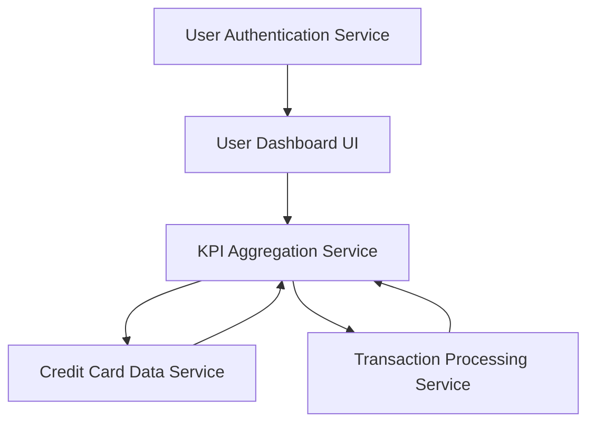

#### 1. High-Level Design

- **Summary:** This epic provides a consolidated dashboard displaying key performance indicators (KPIs) for the user's credit card portfolio. Users can view monthly spend, total credit limit, available credit, and outstanding amounts across all cards in a single, responsive interface with real-time or near real-time data refresh.

- **Component Flow:**

- **Integration Points:**
  - **Upstream:** User Authentication Service (for secure access)
  - **Downstream:** Credit Card Data Service (for card details, balances, limits)
  - **Downstream:** Transaction Processing Service (for calculating monthly spend and outstanding amounts)

- **Key Assumptions:**
  - KPI data is aggregated server-side and cached for performance; real-time refresh uses polling or WebSocket connections.
  - Multi-card aggregation assumes all cards belong to authenticated user; credit limits and balances are retrieved per card and summed.

- **NFR Highlights:** Responsive across mobile, tablet, desktop; real-time or near real-time KPI refresh; supports concurrent multi-card viewing without performance degradation.

- **Data Flow:** User logs in via Authentication Service → Dashboard UI requests KPI data → KPI Aggregation Service retrieves card details from Credit Card Data Service and transaction data from Transaction Processing Service → Service calculates monthly spend, total credit limit, available credit, outstanding amounts → Aggregated KPIs displayed on responsive dashboard → Real-time updates pushed to UI.

#### 2. Validation Report

- **Requirements Coverage:** The design covers all scope elements: monthly spend display, total credit limit calculation, available credit tracking, outstanding amount monitoring, multi-card consolidated view, and responsive layout. NFRs for responsive design, real-time refresh, and multi-card performance are addressed. Dependencies on credit card data service, transaction processing service, and user authentication are integrated.