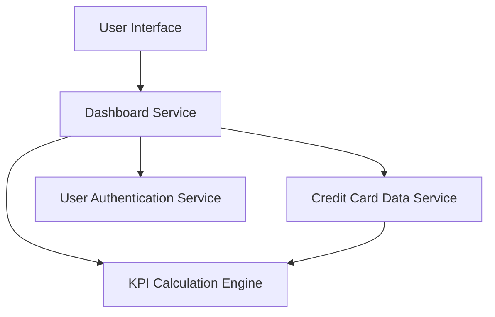

#### 1. High-Level Design

- **Summary:** This epic delivers a consolidated dashboard displaying key performance indicators (KPIs) for users' credit card portfolios. The dashboard shows critical financial metrics including monthly spend, total credit limit, available credit, and outstanding amounts across all credit cards. It provides real-time or near real-time visibility into overall credit card financial health through a modern, responsive interface accessible across devices.

- **Component Flow:**

- **Integration Points:**
  - **Upstream:** User Authentication Service (for secure access control)
  - **Upstream:** Credit Card Data Service (for retrieving card details, balances, limits, and transaction data)
  - **Internal:** KPI Calculation Engine (for aggregating and calculating portfolio-level metrics)

- **Key Assumptions:**
  - Credit card data (balances, limits, transactions) is available in near real-time from the Credit Card Data Service.
  - KPI calculations (monthly spend, outstanding amounts) are performed on-demand or cached with frequent refresh to ensure data freshness.

- **NFR Highlights:** Dashboard must be responsive across mobile, tablet, and desktop devices; KPI data refresh must occur in real-time or near real-time; system must support concurrent viewing of multiple credit cards without performance degradation.

- **Data Flow:** User authenticates via the User Authentication Service and accesses the dashboard. The Dashboard Service retrieves all credit cards associated with the user from the Credit Card Data Service. The KPI Calculation Engine aggregates data across all cards to compute portfolio-level metrics (total credit limit, total available credit, total outstanding amount, monthly spend). Calculated KPIs are displayed in the UI with real-time or near real-time refresh. The responsive layout adapts to the user's device (mobile, tablet, desktop) for optimal viewing.

#### 2. Validation Report

- **Requirements Coverage:** The design fully covers the epic's scope including monthly spend display, total credit limit calculation, available credit tracking, outstanding amount monitoring, multi-card consolidated view, and responsive dashboard layout. The architecture supports the NFRs for responsiveness (mobile, tablet, desktop), real-time data refresh, and multi-card performance. Out-of-scope items (real bank integration, card payments, fund transfers, loans, payment gateway integration) are appropriately excluded from the design.