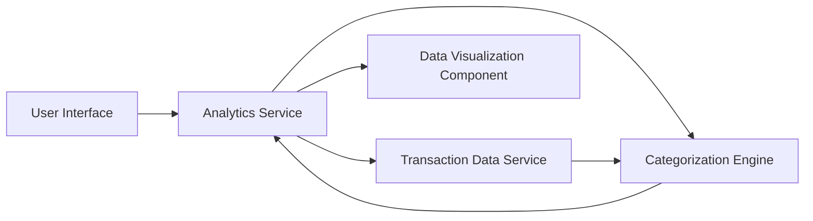

#### 1. High-Level Design

- **Summary:** This epic delivers comprehensive spending analytics through interactive visualizations, enabling users to analyze transactions across 9 predefined categories (Food & Dining, Fuel, Shopping, Travel, Entertainment, Utilities, Healthcare, Education, Miscellaneous). Users can view monthly spend trends, drill down into categories, and identify spending optimization opportunities over time.

- **Component Flow:**

- **Integration Points:**
  - **Upstream:** Transaction Data Service (for retrieving transaction history)
  - **Downstream:** Data Analytics Engine (for trend calculation and pattern recognition)
  - **Internal:** Categorization Engine (for mapping transactions to spending categories)

- **Key Assumptions:**
  - Transactions are pre-categorized or categorized on-the-fly using rule-based or ML categorization engine.
  - Historical data retained for at least 12 months; monthly aggregations pre-computed for performance.

- **NFR Highlights:** Visualizations must load within 2 seconds; support high-volume users; handle 12+ months of historical data; responsive and interactive charts across all devices.

- **Data Flow:** User requests analytics → Analytics Service retrieves transaction data from Transaction Data Service → Categorization Engine maps transactions to predefined categories → Analytics Service calculates monthly trends and aggregations → Data Visualization Component renders interactive charts → User interacts with charts for drill-down analysis.

#### 2. Validation Report

- **Requirements Coverage:** The design fully addresses the epic scope including category-wise visualization, monthly trends, interactive charts, transaction categorization across 9 categories, and time-based comparison. NFRs for 2-second load time, high-volume support, 12-month history, and responsive design are incorporated. Dependencies on transaction data service and analytics engine are identified and integrated.