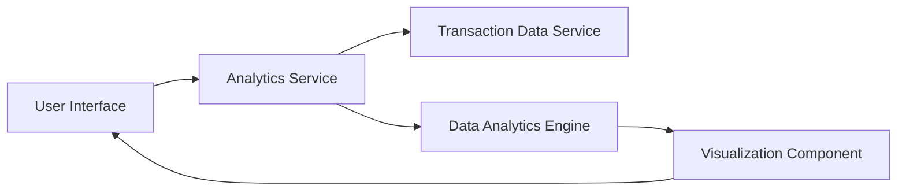

#### 1. High-Level Design

- **Summary:** This epic provides comprehensive spending analytics through interactive visualizations that categorize transactions across 9 predefined categories (Food & Dining, Fuel, Shopping, Travel, Entertainment, Utilities, Healthcare, Education, Miscellaneous). Users can analyze monthly spend trends, drill down into specific categories and time periods, and identify spending patterns to optimize expenses. The system supports historical data analysis for at least 12 months.

- **Component Flow:**

- **Integration Points:**
  - **Upstream:** Transaction Data Service (for retrieving and categorizing transaction history)
  - **Internal:** Data Analytics Engine (for trend calculation, pattern recognition, and aggregations)
  - **Frontend:** Visualization Component (interactive charts library for rendering responsive visualizations)

- **Key Assumptions:**
  - Transactions are pre-categorized by the Transaction Data Service into the 9 predefined categories; no manual categorization is required.
  - Historical transaction data for at least 12 months is available and accessible for trend analysis.

- **NFR Highlights:** Visualizations must load within 2 seconds; system must handle transaction categorization for high-volume users; analytics must support 12+ months of historical data; charts must be responsive and interactive across all device types.

- **Data Flow:** User requests spending analytics from the UI. The Analytics Service queries the Transaction Data Service to retrieve categorized transaction history. The Data Analytics Engine processes this data to calculate category-wise spending totals, monthly trends, and time-based comparisons. Results are passed to the Visualization Component, which renders interactive charts and graphs in the UI. Users can interact with visualizations to drill down into specific categories or time periods, triggering additional queries and re-rendering.

#### 2. Validation Report

- **Requirements Coverage:** The design addresses all core requirements including category-wise spending visualization, monthly spend trends, interactive charts, transaction categorization across 9 categories, spending pattern analysis, and time-based comparison. The architecture supports the NFRs for performance (2-second load time, high-volume transaction handling, 12-month historical data) and responsiveness (interactive charts across all devices). Out-of-scope items (real bank integration, payments, custom category creation, budget setting) are explicitly excluded as per the epic specification.