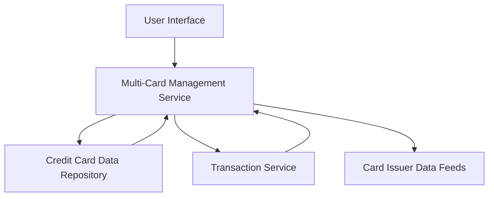

#### 1. High-Level Design

- **Summary:** This epic enables users to manage and monitor multiple credit cards (minimum 10 per user) from a unified interface. Users can view individual card details, perform card-wise spend analysis, track card-specific metrics, and compare cards to optimize usage across their portfolio.

- **Component Flow:**

- **Integration Points:** 
  - **Upstream:** Card issuer data feeds (for card details and updates)
  - **Downstream:** Credit card data repository (for storing card information), Transaction service (for card-wise spending calculations)

- **Key Assumptions:** 
  - Card data is refreshed periodically from card issuer feeds; transaction categorization is handled by the transaction service.
  - User authentication and authorization mechanisms are already in place for secure card data access.

- **NFR Highlights:** System must support minimum 10 cards per user with sub-second response times; data must be encrypted in transit and at rest.

- **Data Flow:** User requests card portfolio view → Multi-Card Management Service retrieves card metadata from Credit Card Data Repository and spending data from Transaction Service → Service aggregates and processes data for each card → Enriched card details with spend analysis returned to UI → User can filter, compare, and drill down into individual card metrics.

#### 2. Validation Report

- **Requirements Coverage:** The design fully covers the epic's stated scope including multiple card display, card-wise spend analysis, individual card details, balance tracking, card selection/filtering, and comparison capabilities. The architecture supports the NFR requirements for performance (sub-second response), scalability (10+ cards), and security (encryption). All identified dependencies (credit card data repository, transaction service, card issuer data feeds) are incorporated into the component flow.