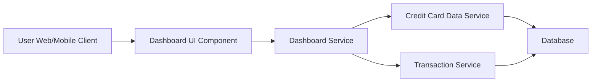

#### 1. High-Level Design

- **Summary:** This epic delivers a consolidated dashboard that displays key performance indicators (KPIs) for the user's credit card portfolio. The dashboard shows monthly spend, total credit limit, available credit, and outstanding amounts, providing users with instant visibility into their overall credit card financial health to support informed spending decisions and avoid credit limit breaches.

- **Component Flow:**

- **Integration Points:**
  - **Upstream:** Credit Card Data Service (provides card details, balances, credit limits)
  - **Upstream:** Transaction Service (provides spending calculations and transaction data)
  - **Downstream:** Dashboard UI renders aggregated data for user consumption

- **Key Assumptions:**
  - Data refresh occurs in near real-time (polling or event-driven); exact refresh frequency not specified.
  - KPI calculations (monthly spend, available credit) are computed server-side; client receives aggregated values.

- **NFR Highlights:** Dashboard must load within 2 seconds, support responsive layouts across desktop and mobile devices, handle real-time data refresh for multiple cards.

- **Data Flow:** User accesses the dashboard via web or mobile client. The Dashboard Service aggregates data by calling the Credit Card Data Service (for card details, limits, balances) and the Transaction Service (for monthly spend calculations). Aggregated KPIs are returned to the Dashboard UI Component, which renders monthly spend, total credit limit, available credit, and outstanding amount in a consolidated view.

#### 2. Validation Report

- **Requirements Coverage:** The design covers all stated scope elements: monthly spend display, total credit limit calculation, available credit tracking, outstanding amount visibility, and consolidated KPI view. The architecture supports responsive layouts and real-time data refresh as specified in NFRs. Integration with Credit Card Data Service and Transaction Service aligns with stated dependencies. Out-of-scope items (real bank integration, payments, fund transfers, loans, payment gateway) are explicitly excluded and not part of this design.