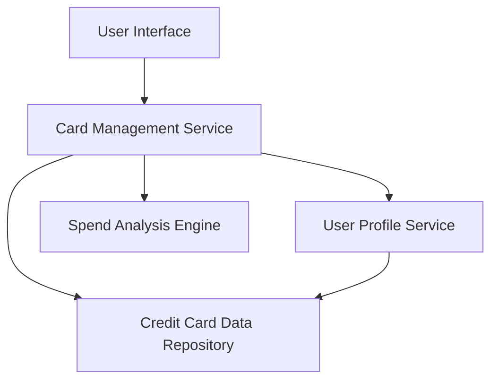

#### 1. High-Level Design

- **Summary:** This epic delivers a unified interface for users to manage and view multiple credit cards simultaneously. Users can access card-specific details, perform card-wise spend analysis, switch between cards, and view individual card performance metrics including spending patterns and balances. The system consolidates multi-card information to eliminate the need for accessing multiple banking portals.

- **Component Flow:**

- **Integration Points:**
  - **Upstream:** User Profile Service (to associate cards with specific users)
  - **Downstream:** Credit Card Data Repository/Service (for retrieving card information, balances, and transaction data)
  - **Internal:** Spend Analysis Engine (for card-wise spending calculations)

- **Key Assumptions:**
  - Card data is pre-registered and available in the credit card data repository; card registration/onboarding is handled outside this epic.
  - Card switching functionality assumes all card data is cached or retrieved efficiently to meet the <300ms latency requirement.

- **NFR Highlights:** System must support at least 10 credit cards per user without performance degradation; card switching latency must be under 300ms; data must be securely isolated per user.

- **Data Flow:** User authenticates and accesses the multi-card interface. The Card Management Service retrieves user-associated card IDs from the User Profile Service, then fetches detailed card information (balances, limits, recent transactions) from the Credit Card Data Repository. The Spend Analysis Engine processes transaction data to generate card-wise spending summaries. All data is aggregated and presented in the UI, allowing users to switch between cards with near-instantaneous response times.

#### 2. Validation Report

- **Requirements Coverage:** The design covers all stated requirements including multiple credit card display, card-wise spend analysis, individual card details view, card selection/switching functionality, and card-specific balance tracking. The architecture supports the NFRs for performance (10+ cards, <300ms switching) and security (per-user data isolation). The design explicitly excludes out-of-scope items (real bank integration, payments, fund transfers, card application/registration) as specified in the epic.