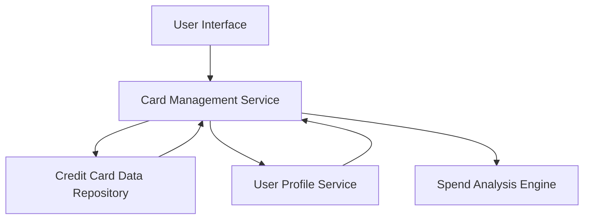

#### 1. High-Level Design

- **Summary:** This epic enables users to manage and view multiple credit cards within a unified interface. Users can view all registered cards, access card-specific details, perform card-wise spend analysis, and switch between cards to monitor individual performance, spending patterns, and balances. The feature consolidates multi-card management, eliminating the need for multiple banking portals.

- **Component Flow:**

- **Integration Points:**
  - **Upstream:** User Profile Service (to associate cards with users)
  - **Downstream:** Credit Card Data Repository/Service (for retrieving card information, balances, and details)

- **Key Assumptions:**
  - Card data is retrieved via API calls with JSON format; card switching uses client-side state management for instant response.
  - User-card associations are pre-established and maintained by the User Profile Service.

- **NFR Highlights:** System must support at least 10 credit cards per user; card switching latency under 300ms; secure per-user data isolation required.

- **Data Flow:** User selects a card from the UI → Card Management Service retrieves card details from Credit Card Data Repository → User Profile Service validates user-card association → Spend Analysis Engine calculates card-specific spending → Results displayed in UI with card-specific balances and spending patterns.

#### 2. Validation Report

- **Requirements Coverage:** The design covers all stated scope elements including multiple credit card display, card-wise spend analysis, individual card details view, card selection/switching functionality, and card-specific balance tracking. The architecture supports the NFRs for performance (10+ cards, <300ms switching) and security (data isolation). Integration dependencies with credit card data repository and user profile service are addressed.