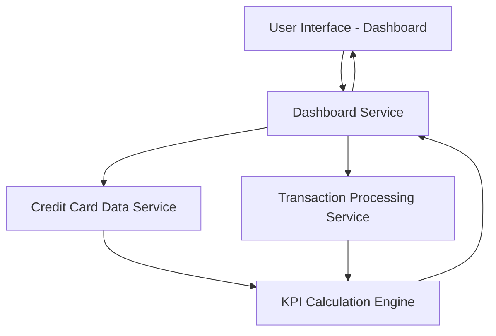

#### 1. High-Level Design

- **Summary:** This epic delivers a consolidated dashboard interface that displays key performance indicators (KPIs) for users' credit card portfolios. It aggregates and presents critical financial metrics including monthly spend, total credit limit, available credit, and outstanding amounts across multiple credit cards, providing users with immediate visibility into their overall credit health through a responsive, modern interface.

- **Component Flow:**

- **Integration Points:**
  - **Upstream:** Credit card data service (retrieves card details and balances), Transaction processing service (provides monthly spend and outstanding amounts)
  - **Downstream:** Provides consolidated KPI data to Analytics service and Transaction Management views

- **Key Assumptions:**
  - Credit card data is refreshed at regular intervals (assumed near real-time or periodic sync); KPI calculations are performed server-side with cached results for performance.

- **NFR Highlights:** Dashboard must support responsive layouts across desktop, tablet, and mobile devices; Page load time must be under 2 seconds; System must handle real-time data updates for KPI calculations.

#### 2. Validation Report

- **Requirements Coverage:** The design fully covers the epic's stated scope including monthly spend display, total credit limit calculation, available credit tracking, outstanding amount monitoring, multiple credit card view, responsive dashboard layout, and consolidated KPI metrics. The component flow demonstrates clear separation between UI, business logic (Dashboard Service), data sources (Credit Card Data Service, Transaction Processing Service), and calculation engine, ensuring all functional requirements can be met. The NFRs for responsive design and sub-2-second load times are addressed through the KPI Calculation Engine with caching strategy.