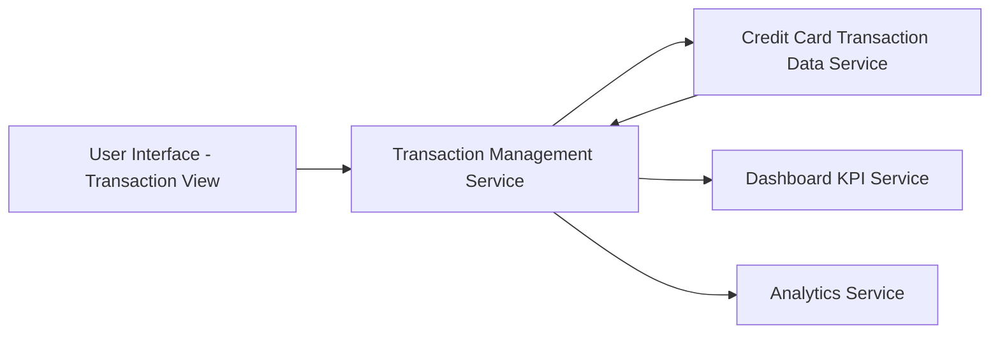

#### 1. High-Level Design

- **Summary:** This epic provides comprehensive transaction management capabilities enabling users to view, track, and analyze all credit card transactions across multiple cards. It maintains detailed transaction histories with real-time updates, feeding accurate transaction data to dashboard KPIs and analytics to ensure complete visibility into spending behavior and transaction patterns.

- **Component Flow:**

- **Integration Points:**
  - **Upstream:** Credit card transaction data service (source of transaction records)
  - **Downstream:** Dashboard KPI service (receives transaction data for monthly spend calculations), Analytics service (provides transaction data for category-wise spending analysis)

- **Key Assumptions:**
  - Transaction data is synchronized in near real-time from the transaction data service; Transaction records include sufficient metadata for categorization and analysis purposes.

- **NFR Highlights:** System must support retrieval of transaction history for multiple cards with response time under 500ms; Transaction data must be accurately synchronized across dashboard and analytics views; Support for handling high transaction volumes.

#### 2. Validation Report

- **Requirements Coverage:** The design comprehensively addresses all scope elements including transaction listing, transaction details view, multi-card transaction tracking, transaction history, real-time transaction updates, and transaction data management. The architecture demonstrates clear data flow from the Credit Card Transaction Data Service through the Transaction Management Service to downstream consumers (Dashboard KPI Service and Analytics Service), ensuring accurate synchronization as specified in NFRs. The sub-500ms response time requirement is achievable through the proposed service-oriented architecture with appropriate caching and indexing strategies.